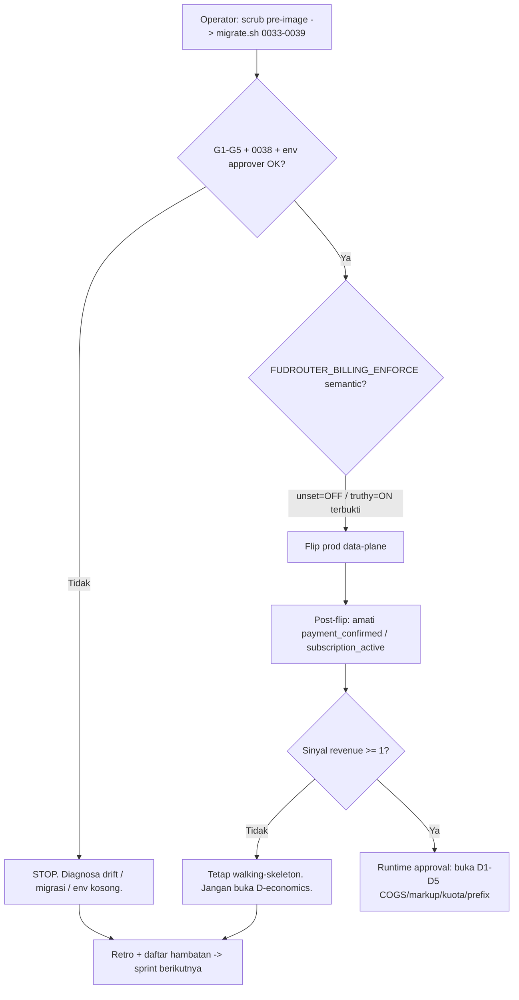

# FR Master Workstream — AI Router
_PM master plan for the next sprint cycle. Draft for brutal judge: devil-advocate + pessimist → tech-lead approve._
_Repo: `fudrouter` · branch `feat/economic-layer` · HEAD `c35d67a`. Status: PRODUCTION — not greenfield._

> ASUMSI ditandai `[A]`, FAKTA ditandai `[F]` dengan sumber. `CODE-EVIDENCE-ONLY` = kode ada tapi belum terverifikasi empiris (bukan VALIDATED). Yang ambigu dinyatakan eksplisit untuk judge.

## §1 — Goal tree: 13 kriteria → subgoal → objektif → task

Legenda status: ✅ DONE · ⛔ BLOCKED-operator (bukan task tim) · ⏸ DEFERRED (revenue gate) · 🔵 TO-DO (sprint ini) · 🔀 GATE/DECISION

### 1. Kode rapi (clean code)
- **Subgoal:** satu konvensi, nol kode mati. **Objektif:** `golangci`/`tsc --noEmit` bersih; 0 build warning baru.
- ✅ S0–S7 + security hackathon: monorepo tersusun (`apps/{console,router,workers,scheduler}`, `db/`, `ops/`, `packages/platform`) — [F] git log `2d5793d`.
- 🔵 **T1 (BE A+B):** setelah merge Mayar, jalankan `go vet` + `tsc` dan nol-kan warning yang _dibawa_ cabang. Delegasi: BackendDev A/B.

### 2. Terstruktur (structured)
- **Subgoal:** role-first layout dipertahankan; nol direktori yatim. **Objektif:** `ops/verify` structure-gate hijau.
- ✅ Layout gate + `ops/verify/` sudah ada — [F] commit `b2bec7f`, `6a7c114`.
- 🔵 **T2 (FE):** respek batas `packages/platform` vs `apps/web` saat integrasi checkout Mayar.

### 3. Ringan (lightweight)
- **Subgoal:** hot-path tanpa alokasi/copy mubazir. **Objektif:** SSE relay + `/v1/models` tetap di bawah budget latensi (bench pin).
- ✅ Admission cache, rendered-body cache, quota UTC-anchor — [F] `57cc1b1`, `b36e05`, `20f531d`.
- 🔀 **T3 (TL, SEBELUM T7):** `fudrouter-opt` `6c1500c` BELUM merged di tip [F]. Putuskan **merge vs hanya-tip**. T7 hanya valid bila T3 = "merge"; T3 = "hanya-tip" → T7 **dibatalkan** (bukan dijadwalkan).

### 4. Tidak redundant (no redundancy)
- **Subgoal:** satu money-formatter, satu design layer, nol shim/alias. **Objektif:** `tokens.test.ts` + `contract lock` hijau, 0 re-export mati.
- ✅ SvelteKit→React cutover + drop `$app`/`$lib` alias shim + kolaps Tailwind/bespoke — [F] `2362648`, `8483b28`, `66efceb`.
- 🔵 **T4 (FE):** jangan ciptakan formatter/komponen kedua saat checkout; pakai barrel `$lib/ui`.

### 5. Terdokumentasi (documented)
- **Subgoal:** setiap keputusan ber-ADR/live-doc. **Objektif:** ADR + `PRODUCT.md` + runbook terkini; spec drift 0.
- ✅ `docs/specs`, `docs/audit`, 5+ ADR, `AGENTS.md`, `DESIGN.md` — [F] `ef1ac4e`, `31af7ff`.
- 🔵 **T5 (QA):** catat ADR Mayar (re-fetch vs trust webhook) pasca-merge — SERTA webhook hardening: akui "hint-only no-auth" + amplifikasi re-fetch (replay tak mint uang, tapi amplifikasi GET ke `api.mayar` tetap terbuka) ATAU tambah HMAC/allow-list; sertakan hasil G6.

### 6. Tidak ada bug (no bugs)
- **Subgoal:** kontrak terkunci, defect tertutup. **Objektif:** contract 175 (baseline tip) → 176 pasca-Mayar; 0 P0/P1 terbuka.
- ✅ P0 public-grant ditutup (W1–W8, C1–C5) + SSRF DNS-rebind + XFF + auth bypass — [F] `7bd7045`, `ecf9816`, `2664dd0`.
- ⛔ **BUG di prod (BLOCKED-operator):** 2 baris `credit_ledger` `5.55e18` menunggu scrub operator — [F] ground-truth A.1.

### 7. Cepat (fast)
- **Subgoal:** observability latensi ujung-ke-ujung. **Objektif:** percentile P95 tersedia; retry-dan-park bounded.
- ✅ Breaker, fail-over 429/5xx, bound walk, retry-after, credential-health ranking — [F] `25275e6`, `1e98f4d`, `94b5310`, `1d27239`.
- 🔵 **T6 (BI, lipat ke T12):** instrumentasi funnel+latensi agar "cepat" terukur, bukan opini. Funnel = jujur 0 sampai flip prod (sinyal belum diinstrumentasi); latency percentile = deferred.

### 8. Routing baik (good routing)
- **Subgoal:** routing policy editor + simulasi berlaku di data plane. **Objektif:** 100% model published sesuai probe; 0 dangling virtual.
- ✅ Routing policies editor, route simulation, virtual/unrestricted, per-account 404 failover — [F] `98846d2`, `da3bb0f`, `819f683`.
- 🔵 **T7 (BE B):** verifikasi `fudrouter-opt` hot-path & quota anchor konsisten dengan policy editor (reconcile). — **Hanya valid bila T3 = "merge"**; T3 = "hanya-tip" → T7 dibatalkan.

### 9. Payment gateway fast
- **Subgoal:** gateway nyata (bukan free-access flag) live & fail-closed. **Objektif:** pembayaran Mayar → webhook → confirm→grant < 60s (sandbox).
- 🔀 **G6 (BE A + DevOps): pre-merge gate sandbox probe** — SEBELUM `git merge feat/mayar-gateway`. Probe sandbox: catat `create.transactionId` nyata, `GET /transactions/{id}`, assert `id === transactionId` + `amount` integer IDR + `status === 'paid'`. Jawab must-verify Mayar-judge: `extraData` echo, `GET /transactions/{id}` vs `data.id`, `/hl/v2/payments/simulate`. G6 merah / sandbox absen → T8 tetap boleh merge TAPI wajib deklarasi eksplisit "kode mati sampai G6 hijau" (bukan "merged & smoke hijau").
- 🟡 **T8 (BE A): MERGE `feat/mayar-gateway`** (adapter + webhook re-fetch + reconcile + wired checkout; fail-closed) + `MAYAR_*` env. — [F] unmerged `0ee63d4`+`c1efebe`; P1. GATED pada G6. Termasuk perbaikan urutan middleware: `enabled()` gate SEBELUM `ipLimit`, rate-limit SEBELUM `express.raw`; default OFF (`MAYAR_WEBHOOK_ENABLED`).
- ⛔ Prod switch tetap menunggu operator (scrub+migrasi+env).

### 10. Bot Telegram/Discord untuk payment & info
- **Subgoal:** bot menutup loop claim + approval di produksi. **Objektif:** `payment.status='claimed'` tertulis dari bot; approver allow-list aktif.
- ✅ Adapter C1/C2 + durable claim writer (Sprint #10) + durable escalation B5b + C2 allow-list wire — [F] `1f613ca`, `91f70bf`, `abc6aaf`, `0c7acb8`.
- 🔵 **T9 (BE B):** verifikasi `recordClaim` ter-wire ke claim path nyata (retro risiko #3) — smoke test.

### 11. Secure
- **Subgoal:** zero-trust semua boundary, fail-closed. **Objektif:** 0 SSRF/authz/bypass kategori critical; pin trusted-upstream.
- ✅ netguard V6 parity, pinned upstream, catalog probe pin, origin hardening, rate-limit — [F] `8b2f73`, `1f39600`, `5110ac4`, `2664dd0`.
- ⛔ Env approver `FUDROUTER_TELEGRAM/DISCORD_APPROVER_USERS` WAJIB (fail-closed) — operator.

### 12. Best practices
- **Subgoal:** CI gate doctrine + contract-first + test pin. **Objektif:** CI hijau; contract regenerasi otomatis.
- ✅ CI typecheck/vet/test, contract lock `routes.json`, e2e harness React — [F] `6803dbcd`, `efc0f47`.
- 🔵 **T10 (QA):** regen contract **175→176** (baseline 175, delta +1 `/api/mayar/webhook`) + smoke post-Mayar.

### 13. Tujuan lainnya (revenue first)
- **Subgoal:** capai sinyal revenue (≥1 payment confirmed / ≥1 subscription aktif non-admin). **Objektif:** gate D-economics terbuka.
- [F] fr-evidence.md: Revenue kini `$12.15/bln`, 0 subscription aktif non-admin, 0 `provider_cost_rule`, 728 mapping butuh COGS.
- [F] Sinyal revenue (`payment_confirmed` / `subscription_active`) BELUM diinstrumentasi di kode — `git grep` di tip `c35d67a` = 0 match (hanya dokumen ini). T12 = metrik v0 menampilkan **0 statis** sampai flip prod.
- ⏸ **D-economics (COGS/markup/kuota/prefix) ⏸ DEFERRED.** Gate = sinyal revenue. **JANGAN** jadwalkan sebelum gate terbuka.

---

## §2 — Kanban

| Kolom | Task | Assignee |
|---|---|---|
| **Backlog** | D-economics D1–D5 (COGS/markup/kuota/prefix) | ⏸ DEFERRED |
| **Backlog** | COGS buat 728 mapping + 4 risiko ekonomi (provider_cost nil, kuota non-idempoten, prefix publish, selisih tagihan) | ⏸ DEFERRED |
| **Backlog** | Writer `credit_purchase` produksi (frpayg metered) | ⏸ DEFERRED (post-gate) |
| **Backlog** | `fudrouter-opt` hot-path (6c1500c, UNMERGED) | TL: T3 merge-vs-tip dulu |
| **Backlog** | a11y scroll-region `ee408cd` 15→0 (code-evidence-only) | QA verify (U2) |
| **Backlog** | `hack/uxia` `cb1df92` | ⏸ P3 (U5) |
| **Backlog** | `migration/green-tailwind` `6815b43` | 🚫 ARSIP — TIDAK merge (U4) |
| **Sprint-1 Todo** | G6 sandbox probe gate (pre-merge) | BE A + DevOps |
| **Sprint-1 Todo** | T8 merge Mayar gateway + `MAYAR_*` (gated G6) | BE A |
| **Sprint-1 Todo** | T9 verify `recordClaim` claim-path | BE B |
| **Sprint-1 Todo** | T1 vet/tsc clean pasca-merge | BE A+B |
| **Sprint-1 Todo** | T4 checkout UX pakai token orange + a11y | FE |
| **Sprint-1 Todo** | T2 respek batas platform vs web | FE |
| **Sprint-1 Todo** | T10 contract regen 175→176 + smoke | QA |
| **Sprint-1 Todo** | T5 ADR Mayar re-fetch + webhook hardening | QA |
| **Sprint-1 Todo** | T11 runbook operator + env `FUDROUTER_BILLING_ENFORCE` | DevOps |
| **Sprint-1 Todo** | T12 revenue-funnel metrik (post-merge, jujur 0 sampai flip) | BI |
| **Sprint-1 Todo** | T13 acquisition funnel (landing→pricing→signup) | Marketing |
| **In-Progress** | (kosong di awal sprint) | — |
| **Review** | TL: T3 merge-vs-tip + merge Mayar + merge-state FINAL (§7) | Tech-lead |
| **Done** | S0–S7 + Sprint #10 + security hackathon (W1–W8) | ✅ |

**Catatan BLOCKED-operator** (bukan Sprint-1 task, diajukan sebagai runbook): A1 scrub 2 baris korup · migrasi 0033–0039 (0038 uniq wajib) · env approver · flip prod go/no-go G1–G5.

---

## §3 — Persona

**1. Rizal — operator rayon (admin/ops).** Goal: flip prod aman & reversibel, lihat drift 0. Pain: data korup + migrasi tertahan = takut self-lockout. Solusi: runbook eksplisit (scrub pre-image + migrate + G1–G5).

**2. Dewi — anggota komunitas berbayar via bot.** Goal: bayar paket murah `frcheap` (100k/28d) via Telegram, langsung dapat akses. Pain: bayar tapi tidak langsung aktif / tidak tahu status. Solusi: bot confirm→grant + status `claimed` jujur. — **[A] solution-biased/directional** (bot belum menulis `claimed` di prod).

**3. Andi — developer konsumen API.** Goal: satu API key, banyak model, metering jelas. Pain: takut diblokir tanpa sebab / harga tidak transparan. Solusi: quota UTC-anchor deterministik + priced catalog + status model honest. — **[A] solution-biased/directional** (priced catalog masih deferred D-economics).

---

## §4 — Pain-point tracing (pain → masalah sebenarnya → fitur → validasi)

| Pain | Masalah sebenarnya | Fitur/aksi | Validasi | Status |
|---|---|---|---|---|
| Payment gateway "lambat/belum jalan" | Tidak ada gateway nyata; env `FUDROUTER_BILLING_ENFORCE` unset (OFF) di prod → `FreeAccessNoPaymentGateway` (mapping internal `limits.go`) aktif | Merge Mayar + webhook re-fetch + reconcile + checkout wired | VALIDATED [F]: 0 subs aktif, P0 self-grant diamati. Sisa: drift pasca-bayar → ditutup reconcile+confirm→grant | 🔵 P1 |
| Prod belum bisa di-flip | 2 baris korup + migrasi tertahan (0032) + env kosong | Runbook operator (scrub + migrate + env + G1–G5) | VALIDATED [F]: prod `schema_migration`=0032, 2 baris `5.55e18` | ⛔ BLOCKED-operator |
| Self-grant gratis (P0) | `/api/payment/confirm` publik (DIHAPUS W8) | Authz W1–W8 + operator caps | VALIDATED + DONE [F] `7bd7045`, contract 176→175 | ✅ |
| Revenue gate belum tercapai | Gateway belum live → 0 payment confirmed → D-economics mati | Mayar merge (gated G6) + acquisition funnel | VALIDATED [F]: 0 confirmed, 0 non-admin subs. [F] sinyal belum diinstrumentasi (0 match tip); sisa: apakah setelah payment ada? → [A] belum terbukti | 🔵 |
| COGS/markup mati | D-economics deferred by design (0 `provider_cost_rule`) | Revenue gate → buka D1–D5 | DEFERRED + [A]: asumsi revenue akan datang | ⏸ |
| a11y scroll tidak keyboard-reachable | Header §7 Tables → 15 violation | `TableWrap` focusable region (15→0) | CODE-EVIDENCE-ONLY (bukan VALIDATED [F]): `DESIGN.md` + `ee408cd` [A] UNMERGED; live screen-reader AT-walk OPEN; QA verify belum | 🔵 verify |

---

## §5 — Product backlog TERPRIORITAS

| # | Item | Rationale |
|---|---|---|
| **P0** | Runbook operator: scrub 2 baris korup + migrasi 0033–0039 (0038 uniq) + env approver + flip G1–G5 | Prod blocker; tanpa ini go-live mustahil & grant writer gagal `ON CONFLICT`. BLOCKED-operator (diajukan, bukan task tim). |
| **P1** | **Merge `feat/mayar-gateway`** + `MAYAR_*` env + **G6 sandbox probe gate** | Satu-satunya jalan menuju `payment confirmed` = buka revenue gate; fail-closed aman; G6 mengunci kontrak vendor. |
| **P1** | Contract regen 175→176 (delta +1) + smoke + verify `recordClaim` claim-path | Keamanan + integritas loop uang; risiko retro #3 harus ditutup. |
| **P2** | a11y scroll-region confirm (code-evidence-only → QA verify) + design token orange `DESIGN.md` (green-tailwind DIARSIPKAN) | UX + a11y; bukan blocker revenue. |
| **P3** | Polish: backup/docs/bench dashboard, drop shim sisa, clean stale refs | Rapikan; rendah risiko. |
| ⏸ | D-economics D1–D5 (COGS/markup/kuota/prefix) | DEFERRED — gate revenue belum terbuka (0 payment confirmed, 0 subs). |

---

## §6 — Sprint-1 plan (4 jam)

**Tujuan:** tutup loop uang nyata (Mayar merge, GATED G6) + siapkan runbook operator + instrumentation funnel (jujur 0 sampai flip), TANPA menyentuh D-economics.

**Output terukur:**
1. G6 hijau ATAU deklarasi eksplisit "kode mati sampai G6 hijau";
2. Mayar merged + smoke hijau (hanya bila G6 hijau);
3. contract 175→176;
4. runbook flip+revert (env `FUDROUTER_BILLING_ENFORCE`);
5. revenue-funnel metric v0 = 0 statis;
6. `recordClaim` terbukti ter-wire.

**Tim & tanggung jawab (2BE/1FE/1QA/1DevOps/1Mkt/1BI):**
- **BE A + DevOps** — G6 sandbox probe gate (pre-merge) → T8 merge Mayar + `MAYAR_*` + middleware-order fix.
- **BE B** — T9: `recordClaim` claim-path smoke (independent).
- **FE** — T2+T4 (post-merge): checkout UX token orange + a11y; batas platform/web.
- **QA** — T5+T10 (post-merge): ADR Mayar re-fetch + webhook hardening; contract regen 175→176 + smoke.
- **DevOps** — T11: env provisioning `FUDROUTER_BILLING_ENFORCE` + runbook operator + G6 gate.
- **Marketing** — T13: acquisition funnel (landing→pricing→signup).
- **BI** — T12 (post-merge): revenue metric v0 = 0 statis sampai flip prod.
- **TL** — T3: putuskan merge-vs-tip `fudrouter-opt` (SEBELUM T7; T7 gated pada T3=merge).

**Timeline / daily-scrum checkpoint (4 jam):**
- 0.0h — **checkpoint 1:** kickoff + TL putuskan T3 (merge-vs-tip fudrouter-opt); laporkan blocker operator (scrub/migrasi paralel).
- 0.5h — **G6 sandbox probe (pre-merge gate):** assert `create.transactionId` vs `GET /transactions/{id}`, amount IDR, status paid; jawab `extraData`/GET-vs-`data.id`/simulate.
- 1.0h — **checkpoint 2:** G6 verdict; bila hijau → `git fetch origin feat/mayar-gateway` + merge; QA mulai contract.
- 2.0h — **checkpoint 3:** smoke Mayar sandbox; FE checkout pertama.
- 3.0h — **checkpoint 4:** QA hijau; DevOps runbook draft.
- 4.0h — **review + retro:** TL approve; daftar hambatan → sprint berikutnya.

**Definisi Done:** G6 hijau ATAU deklarasi eksplisit "kode mati sampai G6 hijau"; (bila merge) Mayar merged ke `feat/economic-layer`; `go vet`/`tsc` bersih; contract 175→176; smoke sandbox pembayaran confirmed→grant dalam <60s (hanya bila G6 hijau); webhook hardening tercatat di ADR; runbook operator tersimpan; metrik funnel v0 = 0 statis.

**Acceptance criteria (terukur):**
1. `git fetch origin feat/mayar-gateway`; **G6 probe sandbox hijau** (`id === create.transactionId`, `amount` integer IDR, `status==='paid'`; jawab `extraData` echo, `GET /transactions/{id}` vs `data.id`, `/hl/v2/payments/simulate`); lalu `git merge feat/mayar-gateway` → CI hijau, 0 warning baru. Bila G6 merah/absent → merge boleh TAPI deklarasi eksplisit "kode mati sampai G6 hijau" (bukan "merged & smoke hijau").
2. `POST /api/pages/subscription/checkout` → `createMayarPayment` + `POST /api/mayar/webhook` (re-fetch settle) → subscription granted (sandbox), fail-closed saat `MAYAR_*` kosong.
3. `recordClaim` menulis `payment.status='claimed'` pada claim path nyata (proven by smoke).
4. Contract lock **175→176** stabil (baseline 175, delta +1 `/api/mayar/webhook`), tidak drift.
5. Runbook G1–G5 + 0038 + env approver + env `FUDROUTER_BILLING_ENFORCE` tercantum & reversible.
6. Funnel metric menampilkan `payment_confirmed` & `subscription_active` = **0 statis** sampai flip prod (sinyal BELUM diinstrumentasi di kode).

**Urutan (hormati dependensi):** operator scrub/migrasi (paralel, di luar sprint) → **T3 (TL, merge-vs-tip)** → **G6 probe (pre-merge)** → Mayar merge (BE, gated G6, fetch eksplisit) → contract (QA) → smoke sandbox (QA+BE) → runbook (DevOps). **T7 gated pada T3=merge; D-economics TIDAK dijadwalkan; T12 post-merge.**

---

## §7 — Design direction

**Token/system:** MEMBANGUN di atas `DESIGN.md` (orange), bukan mencipta kedua. Tier-1 primitives (`#FF6C11`, `#FF8A3D`, dst) → Tier-2 semantic (`primary`, `onPrimary`, `warning`). Satu aksen orange = satu aksi per screen. Motion scale 2 durasi (`durFast` 120ms, `durMed` 320ms) + satu easing ease-out.

**Atomic/component:** pakai barrel `$lib/ui` (Button, Card, TableWrap, Badge, StatCard, UsageChart, dsb). Respek "one primary action/screen", "status = warna + kata", "48px headline never on API-key table".

**a11y:** `fix/a11y-scroll-regions` 15→0: `TableWrap` `tabindex=0` + `role=region` + label; skip-link; fokus `outline` (bukan shadow); `prefers-reduced-motion` fail-closed; 24×24 target (WCAG 2.5.8); 1.4.12 text-spacing. — **CODE-EVIDENCE-ONLY (bukan VALIDATED [F])**: `DESIGN.md` + `ee408cd` [A] UNMERGED sampai QA verify; live screen-reader AT-walk OPEN.

**Env flag (kanonik):** satu nama operator-facing = `FUDROUTER_BILLING_ENFORCE` (unset=OFF, truthy=ON) di SEMUA runbook/diagram. `FreeAccessNoPaymentGateway` = hanya mapping internal `limits.go`, bukan nama operator.

**Informasi arsitektur (IA):** Public→Pricing→Models→Signup→Dashboard; Member→Keys/Usage/Account; Admin→Overview/Providers/Models/Users/Connections/Requests. Page berikutnya memakai `PageHeader` + `Section` + `Guide`/`Facts`, bukan template baru.

**Merge-state FINAL (TL adjudikasi D):**

| Cabang | Tip | Status sprint-1 |
|---|---|---|
| netguard whole-prefix | `1f39600` | ✅ MERGED (block `2002::/16` + `64:ff9b::/96` UTUH) |
| hack/netsec | `ecf9816` + `20c1687` | ✅ content-merged (cherry ekuivalen) |
| hack/be-routercore | (content-merged) | ✅ content-merged |
| feat/mayar-gateway | `0ee63d4` + `c1efebe` | 🔵 U1 — MERGE P1, GATED G6 (mandat #1) |
| fix/a11y-scroll-regions | `ee408cd` | 🟡 U2 — VERIFY dulu; merge P2 setelah QA confirm |
| fudrouter-opt | `6c1500c` | 🔀 U3 — T3 TL putuskan merge vs hanya-tip; T7 menunggu T3 |
| migration/green-tailwind | `754d4b1`, `91d3da1`, `6815b43` | 🚫 U4 — TIDAK MERGE (arsip); orange `DESIGN.md` = source of truth |
| hack/uxia | `cb1df92` | ⏸ U5 — TUNDA, backlog P3 |

**Risiko reconcile:** TL SUDAH PUTUS satu arah: `DESIGN.md` (orange) = source of truth; `migration/green-tailwind` (tip `6815b43`, UNMERGED) DIARSIPKAN — TIDAK merge.

### Diagram decision-flow (genuin, mermaid) — go-live flip gate

Diagram ini genuin: memodelkan **dua gate bertingkat nyata** — (1) go-live flip (G1–G5 + 0038 + env) dan (2) revenue gate untuk D-economics. Bukan dekorasi. Catatan: `payment_confirmed`/`subscription_active` BELUM diinstrumentasi di kode (0 match tip); observasi node F menunggu T12 v0 (0 statis sampai flip prod).

---

## §8 — Sprint cadence

- **Daily scrum (4 jam):** 5 checkpoint (0/1/2/3/4h); 3 pertanyaan: apa selesai, apa hambatan, apa berikutnya.
- **Review (akhir sprint):** demo Mayar sandbox + contract lock 175→176 + funnel metric (0 statis); verifikasi definisi-done + acceptance criteria di §6.
- **Retro:** catat residu (mis. drift, `recordClaim` seam, a11y AT-walk, G6 verdict) → back ke Backlog §5.
- **Loop:** TL approve/devil+pessimist judge → sprint berikutnya (D-economics hanya bila gate terbuka) → repeat.

---

## Asumsi kritis untuk judge (brutal)

1. **[F] Merge-state FINAL (adjudikasi TL D) — lihat tabel §7:** MERGED (content) di tip `c35d67a` = netguard whole-prefix (`1f39600`), hack/netsec (`ecf9816`+`20c1687`), hack/be-routercore (content-merged). UNMERGED = feat/mayar-gateway (`0ee63d4`+`c1efebe`, U1 gated G6), fix/a11y-scroll-regions (`ee408cd`, U2 verify), fudrouter-opt (`6c1500c`, U3 T3), migration/green-tailwind (`754d4b1`/`91d3da1`/`6815b43`, U4 arsip TIDAK merge), hack/uxia (`cb1df92`, U5 backlog P3).
2. **[F] Direction warna:** TL sudah putus — orange `DESIGN.md` = source of truth; green-tailwind diarsipkan (TIDAK merge).
3. **[A] Vendor Mayar:** sandbox access + `MAYAR_*` credential tersedia — diverifikasi di G6 probe (`extraData` echo, `GET /transactions/{id}` vs `data.id`, `/hl/v2/payments/simulate`); bila gagal/absent → deklarasi "kode mati sampai G6 hijau".
4. **[F] Revenue `$12.15/bln`** — sumber `fr-evidence.md` (satu label dgn §1.13); ukur ulang saat revenue gate terbuka untuk konfirmasi.
5. **[A] Operator tersedia** menjalankan scrub/migrasi/flip dalam window sprint (di luar task tim).

## Sprint-1 v2 DISPATCH (FINAL — adjudikasi TL bagian F)

| ID | Task | Assignee | Syarat |
|---|---|---|---|
| G6 | Sandbox probe gate (`create.transactionId` vs GET id; amount IDR; status paid; `extraData`; simulate) | BE A + DevOps | SEBELUM T8 merge; merah → deklarasi "kode mati sampai G6 hijau" |
| T8 | Merge `feat/mayar-gateway` + `MAYAR_*` + middleware-order fix | BE A | GATED G6; `git fetch` eksplisit; acceptance baru |
| T9 | Verify `recordClaim` claim-path smoke | BE B | Independent |
| T1 | `go vet` + `tsc --noEmit` clean | BE A+B | Post-merge Mayar |
| T5 | ADR Mayar re-fetch + webhook hardening (hint-only/amplifikasi → HMAC/allow-list) | QA | Post-merge; sertakan hasil G6 |
| T10 | Contract regen 175→176 + smoke | QA | Post-merge; delta +1 |
| T11 | Runbook operator + env `FUDROUTER_BILLING_ENFORCE` | DevOps | Nama env kanonik; langkah fetch |
| T13 | Acquisition funnel (landing→pricing→signup) | Marketing | Independent, low risk |
| T12 | Revenue funnel metrik (`payment_confirmed`/`subscription_active`, 0 sampai flip) | BI | Post-merge Mayar |
| T2/T4 | Checkout UX (token orange + a11y + batas platform/web) | FE | Post-merge Mayar; pakai wiring branch |

**TIDAK di-dispatch:** T7 (menunggu T3), T3 (keputusan TL, prakondisi), D-economics D1–D5 (menunggu sinyal revenue), prod flip (BLOCKED-operator), green-tailwind (arsip), uxia (backlog P3), T6 latency (deferred / lipat ke T12 funnel).