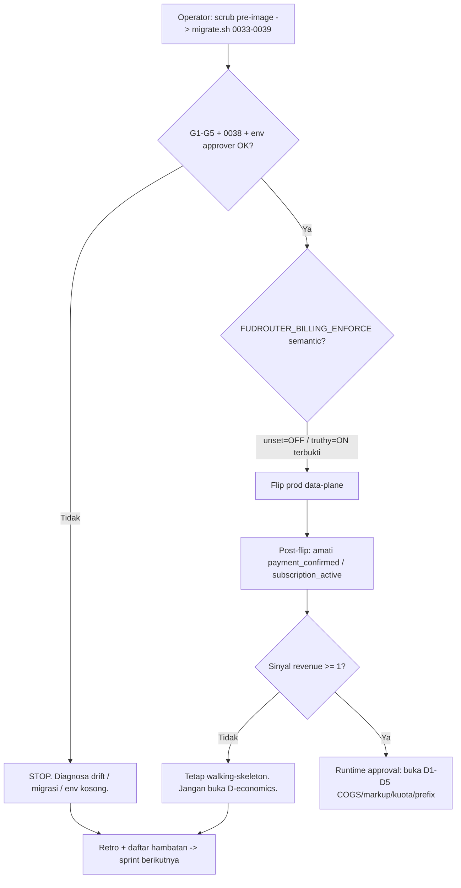

# FR Master Workstream — AI Router
_PM master plan for the next sprint cycle. Draft for brutal judge: devil-advocate + pessimist → tech-lead approve._
_Repo: `fudrouter` · branch `feat/economic-layer` · HEAD `8405399`. Status: PRODUCTION — not greenfield._

> ASUMSI ditandai `[A]`, FAKTA ditandai `[F]` dengan sumber. Yang ambigu dinyatakan eksplisit untuk judge.

## §1 — Goal tree: 13 kriteria → subgoal → objektif → task

Legenda status: ✅ DONE · ⛔ BLOCKED-operator (bukan task tim) · ⏸ DEFERRED (revenue gate) · 🔵 TO-DO (sprint ini)

### 1. Kode rapi (clean code)
- **Subgoal:** satu konvensi, nol kode mati. **Objektif:** `golangci`/`tsc --noEmit` bersih; 0 build warning baru.
- ✅ S0–S7 + security hackathon: monorepo tersusun (`apps/{console,router,workers,scheduler}`, `db/`, `ops/`, `packages/platform`) — [F] git log `2d5793d`.
- 🔵 **T1 (BE A+B):** setelah merge Mayar, jalankan `go vet` + `tsc` dan nol-kan warning yang _dibawa_ cabang. Delegasi: BackendDev A/B.

### 2. Terstruktur (structured)
- **Subgoal:** role-first layout dipertahankan; nol direktori yatim. **Objektif:** `ops/verify` structure-gate hijau.
- ✅ Layout gate + `ops/verify/` sudah ada — [F] commit `b2bec7f`, `6a7c114`.
- 🔵 **T2 (FE):** respek batas `packages/platform` vs `apps/web` saat integrasi checkout Mayar.

### 3. Ringan (lightweight)
- **Subgoal:** hot-path tanpa alokasi/copy mubazir. **Objektif:** SSE relay + `/v1/models` tetap di bawah budget latensi (bench pin).
- ✅ Admission cache, rendered-body cache, quota UTC-anchor, `fudrouter-opt` hot-path — [F] `57cc1b1`, `b36e05`, `20f531d`.
- ⏳ **T3 di-review TL:** `fudrouter-opt` `6c1500c` — tentukan merged/hanya-tip (reconcile di Sprint-1 T10).

### 4. Tidak redundant (no redundancy)
- **Subgoal:** satu money-formatter, satu design layer, nol shim/alias. **Objektif:** `tokens.test.ts` + `contract lock` hijau, 0 re-export mati.
- ✅ SvelteKit→React cutover + drop `$app`/`$lib` alias shim + kolaps Tailwind/bespoke — [F] `2362648`, `8483b28`, `66efceb`.
- 🔵 **T4 (FE):** jangan ciptakan formatter/komponen kedua saat checkout; pakai barrel `$lib/ui`.

### 5. Terdokumentasi (documented)
- **Subgoal:** setiap keputusan ber-ADR/live-doc. **Objektif:** ADR + `PRODUCT.md` + runbook terkini; spec drift 0.
- ✅ `docs/specs`, `docs/audit`, 5+ ADR, `AGENTS.md`, `DESIGN.md` — [F] `ef1ac4e`, `31af7ff`.
- 🔵 **T5 (QA):** catat ADR untuk keputusan Mayar (re-fetch vs trust webhook) pasca-merge.

### 6. Tidak ada bug (no bugs)
- **Subgoal:** kontrak terkunci, defect tertutup. **Objektif:** contract count 176→175 stabil; 0 P0/P1 terbuka.
- ✅ P0 public-grant ditutup (W1–W8, C1–C5) + SSRF DNS-rebind + XFF + auth bypass — [F] `7bd7045`, `ecf9816`, `2664dd0`.
- ⛔ **BUG di prod (BLOCKED-operator):** 2 baris `credit_ledger` `5.55e18` menunggu scrub operator — [F] ground-truth A.1.

### 7. Cepat (fast)
- **Subgoal:** observability latensi ujung-ke-ujung. **Objektif:** percentile P95 tersedia; retry-dan-park bounded.
- ✅ Breaker, fail-over 429/5xx, bound walk, retry-after, credential-health ranking — [F] `25275e6`, `1e98f4d`, `94b5310`, `1d27239`.
- 🔵 **T6 (BI):** instrumentasi funnel+latensi (lihat T12) agar "cepat" terukur, bukan opini.

### 8. Routing baik (good routing)
- **Subgoal:** routing policy editor + simulasi berlaku di data plane. **Objektif:** 100% model published sesuai probe; 0 dangling virtual.
- ✅ Routing policies editor, route simulation, virtual/unrestricted, per-account 404 failover — [F] `98846d2`, `da3bb0f`, `819f683`.
- 🔵 **T7 (BE B):** verifikasi `fudrouter-opt` hot-path & quota anchor konsisten dengan policy editor (reconcile).

### 9. Payment gateway fast
- **Subgoal:** gateway nyata (bukan free-access flag) live & fail-closed. **Objektif:** pembayaran Mayar → webhook → confirm→grant < 60s (sandbox).
- 🟡 **T8 (BE A): MERGE `feat/mayar-gateway`** (adapter + webhook re-fetch + reconcile + wired checkout; fail-closed) + `MAYAR_*` env. — [F] unmerged `0ee63d4`+`c1efebe`; P1.
- ⛔ Prod switch tetap menunggu operator (scrub+migrasi+env).

### 10. Bot Telegram/Discord untuk payment & info
- **Subgoal:** bot menutup loop claim + approval di produksi. **Objektif:** `payment.status='claimed'` tertulis dari bot; approver allow-list aktif.
- ✅ Adapter C1/C2 + durable claim writer (Sprint #10) + durable escalation B5b + C2 allow-list wire — [F] `1f613ca`, `91f70bf`, `abc6aaf`, `0c7acb8`.
- 🔵 **T9 (BE B):** verifikasi `recordClaim` ter-wire ke claim path nyata (retro risiko #3) — smoke test.

### 11. Secure
- **Subgoal:** zero-trust semua boundary, fail-closed. **Objektif:** 0 SSRF/authz/bypass kategori critical; pin trusted-upstream.
- ✅ netguard V6 parity, pinned upstream, catalog probe pin, origin hardening, rate-limit — [F] `8b2f73`, `1f39600`, `5110ac4`, `2664dd0`.
- ⛔ Env approver `FUDROUTER_TELEGRAM/DISCORD_APPROVER_USERS` WAJIB (fail-closed) — operator.

### 12. Best practices
- **Subgoal:** CI gate doctrine + contract-first + test pin. **Objektif:** CI hijau; contract regenerasi otomatis.
- ✅ CI typecheck/vet/test, contract lock `routes.json`, e2e harness React — [F] `6803dbcd`, `efc0f47`.
- 🔵 **T10 (QA):** regen contract 176→175 + smoke post-Mayar.

### 13. Tujuan lainnya (revenue first)
- **Subgoal:** capai sinyal revenue (≥1 payment confirmed / ≥1 subscription aktif non-admin). **Objektif:** gate D-economics terbuka.
- [F] Revenue kini `$12.15/bln`, 0 subscription aktif non-admin, 0 `provider_cost_rule`, 728 mapping butuh COGS.
- ⏸ **D-economics (COGS/markup/kuota/prefix) ⏸ DEFERRED.** Gate = sinyal revenue. **JANGAN** jadwalkan sebelum gate terbuka.

---

## §2 — Kanban

| Kolom | Task | Assignee |
|---|---|---|
| **Backlog** | D-economics D1–D5 (COGS/markup/kuota/prefix) | ⏸ DEFERRED |
| **Backlog** | COGS buat 728 mapping + 4 risiko ekonomi (provider_cost nil, kuota non-idempoten, prefix publish, selisih tagihan) | ⏸ DEFERRED |
| **Backlog** | Writer `credit_purchase` produksi (frpayg metered) | ⏸ DEFERRED (post-gate) |
| **Backlog** | `fudrouter-opt` hot-path (bila belum merged) | TL review |
| **Backlog** | a11y scroll-region konfirmasi `ee408cd` 15→0 | QA verify |
| **Sprint-1 Todo** | T8 merge Mayar gateway + `MAYAR_*` | BE A |
| **Sprint-1 Todo** | T9 verify `recordClaim` claim-path | BE B |
| **Sprint-1 Todo** | T7 verify `fudrouter-opt` + quota anchor | BE B |
| **Sprint-1 Todo** | T1 vet/tsc clean pasca-merge | BE A+B |
| **Sprint-1 Todo** | T4 checkout UX pakai token orange + a11y | FE |
| **Sprint-1 Todo** | T2 respek batas platform vs web | FE |
| **Sprint-1 Todo** | T10 contract regen + smoke | QA |
| **Sprint-1 Todo** | T5 ADR Mayar re-fetch | QA |
| **Sprint-1 Todo** | T11 runbook operator + `MAYAR_*` env provisioning | DevOps |
| **Sprint-1 Todo** | T12 revenue-funnel + latensi metrik | BI |
| **Sprint-1 Todo** | T13 acquisition funnel (landing→pricing→signup) | Marketing |
| **In-Progress** | (kosong di awal sprint) | — |
| **Review** | TL: merge Mayar + reconcile merged-state §B | Tech-lead |
| **Done** | S0–S7 + Sprint #10 + security hackathon (W1–W8) | ✅ |

**Catatan BLOCKED-operator** (bukan Sprint-1 task, diajukan sebagai runbook): A1 scrub 2 baris korup · migrasi 0033–0039 (0038 uniq wajib) · env approver · flip prod go/no-go G1–G5.

---

## §3 — Persona

**1. Rizal — operator rayon (admin/ops).** Goal: flip prod aman & reversibel, lihat drift 0. Pain: data korup + migrasi tertahan = takut self-lockout. Solusi: runbook eksplisit (scrub pre-image + migrate + G1–G5).

**2. Dewi — anggota komunitas berbayar via bot.** Goal: bayar paket murah `frcheap` (100k/28d) via Telegram, langsung dapat akses. Pain: bayar tapi tidak langsung aktif / tidak tahu status. Solusi: bot confirm→grant + status `claimed` jujur.

**3. Andi — developer konsumen API.** Goal: satu API key, banyak model, metering jelas. Pain: takut diblokir tanpa sebab / harga tidak transparan. Solusi: quota UTC-anchor deterministik + priced catalog + status model honest.

---

## §4 — Pain-point tracing (pain → masalah sebenarnya → fitur → validasi)

| Pain | Masalah sebenarnya | Fitur/aksi | Validasi | Status |
|---|---|---|---|---|
| Payment gateway "lambat/belum jalan" | Tidak ada gateway nyata; `FreeAccessNoPaymentGateway` masih ON di prod | Merge Mayar + webhook re-fetch + reconcile + checkout wired | VALIDATED [F]: 0 subs aktif, P0 self-grant diamati. Sisa: drift pasca-bayar → ditutup reconcile+confirm→grant | 🔵 P1 |
| Prod belum bisa di-flip | 2 baris korup + migrasi tertahan (0032) + env kosong | Runbook operator (scrub + migrate + env + G1–G5) | VALIDATED [F]: prod `schema_migration`=0032, 2 baris `5.55e18` | ⛔ BLOCKED-operator |
| Self-grant gratis (P0) | `/api/payment/confirm` publik | Authz W1–W8 + operator caps | VALIDATED + DONE [F] `7bd7045`, contract 176→175 | ✅ |
| Revenue gate belum tercapai | Gateway belum live → 0 payment confirmed → D-economics mati | Mayar merge + acquisition funnel | VALIDATED [F]: 0 confirmed, 0 non-admin subs. Sisa: apakah setelah payment ada? → [A] belum terbukti | 🔵 |
| COGS/markup mati | D-economics deferred by design (0 `provider_cost_rule`) | Revenue gate → buka D1–D5 | DEFERRED + [A]: asumsi revenue akan datang | ⏸ |
| a11y scroll tidak keyboard-reachable | Header §7 Tables → 15 violation | `TableWrap` focusable region (15→0) | VALIDATED [F] DESIGN.md + `ee408cd`; final merge state → [A] reconcile | 🔵 verify |

---

## §5 — Product backlog TERPRIORITAS

| # | Item | Rationale |
|---|---|---|
| **P0** | Runbook operator: scrub 2 baris korup + migrasi 0033–0039 (0038 uniq) + env approver + flip G1–G5 | Prod blocker; tanpa ini go-live mustahil & grant writer gagal `ON CONFLICT`. BLOCKED-operator (diajukan, bukan task tim). |
| **P1** | **Merge `feat/mayar-gateway`** + `MAYAR_*` env + sandbox probe | Satu-satunya jalan menuju `payment confirmed` = buka revenue gate; fail-closed aman. |
| **P1** | Contract regen 176→175 + smoke + verify `recordClaim` claim-path | Keamanan + integritas loop uang; risiko retro #3 harus ditutup. |
| **P2** | a11y scroll-region confirm + design-token reconciliation (orange `DESIGN.md` vs green-Tailwind) | UX + a11y; bukan blocker revenue. |
| **P3** | Polish: backup/docs/bench dashboard, drop shim sisa | Rapikan; rendah risiko. |
| ⏸ | D-economics D1–D5 (COGS/markup/kuota/prefix) | DEFERRED — gate revenue belum terbuka (0 payment confirmed, 0 subs). |

---

## §6 — Sprint-1 plan (4 jam)

**Tujuan:** tutup loop uang nyata (Mayar merge) + siapkan runbook operator + instrumentation funnel, TANPA menyentuh D-economics.

**Output terukur:** (1) Mayar merged & smoke hijau; (2) contract 176→175; (3) runbook flip+revert versi terbaru; (4) revenue-funnel metric dashboard v0; (5) `recordClaim` terbukti ter-wire.

**Tim & tanggung jawab (2BE/1FE/1QA/1DevOps/1Mkt/1BI):**
- **BE A** — T8 merge Mayar + `MAYAR_*` + adapter review.
- **BE B** — T7+T9: `fudrouter-opt`/quota reconcile + `recordClaim` claim-path smoke.
- **FE** — T2+T4: checkout UX dengan token orange + a11y; respek batas platform/web.
- **QA** — T5+T10: ADR Mayar + contract regen + smoke.
- **DevOps** — T11: env provisioning + runbook operator final + sandbox probe gate.
- **Marketing** — T13: acquisition funnel (landing→pricing→signup).
- **BI** — T12: revenue gateway metric (payment_confirmed, subscription_active) sebagai sinyal gate.

**Timeline / daily-scrum checkpoint (4 jam):**
- 0.0h — **checkpoint 1:** kickoff; laporkan blocker operator (scrub/migrasi jalan paralel oleh operator).
- 1.0h — **checkpoint 2:** BE merge Mayar selesai-review; QA mulai contract.
- 2.0h — **checkpoint 3:** smoke Mayar sandbox; FE checkout pertama.
- 3.0h — **checkpoint 4:** QA hijau; DevOps runbook draft.
- 4.0h — **review + retro:** TL approve; daftar hambatan → sprint berikutnya.

**Definisi Done:** Mayar merged ke `feat/economic-layer`; `go vet`/`tsc` bersih; contract 176→175; smoke sandbox pembayaran berstatus confirmed→grant dalam <60s (sandbox); runbook operator tersimpan; metrik funnel hidup.

**Acceptance criteria (terukur):**
1. `git merge feat/mayar-gateway` → CI hijau, 0 warning baru.
2. `POST /api/payment/confirm` + webhook re-fetch → subscription granted (sandbox), fail-closed saat `MAYAR_*` kosong.
3. `recordClaim` menulis `payment.status='claimed'` pada claim path nyata (proven by smoke).
4. Contract lock 176→175 stabil (tidak drift).
5. Runbook G1–G5 + 0038 + env approver tercantum & reversible.
6. Funnel metric menampilkan `payment_confirmed` & `subscription_active` (0 awal).

**Urutan (hormati dependensi):** operator scrub/migrasi (paralel, di luar sprint) → Mayar merge (BE) → contract (QA) → smoke sandbox (QA+BE) → runbook (DevOps). **D-economics TIDAK dijadwalkan** sebelum sinyal revenue.

---

## §7 — Design direction

**Token/system:** MEMBANGUN di atas `DESIGN.md` (orange), bukan mencipta kedua. Tier-1 primitives (`#FF6C11`, `#FF8A3D`, dst) → Tier-2 semantic (`primary`, `onPrimary`, `warning`). Satu aksen orange = satu aksi per screen. Motion scale 2 durasi (`durFast` 120ms, `durMed` 320ms) + satu easing ease-out.

**Atomic/component:** pakai barrel `$lib/ui` (Button, Card, TableWrap, Badge, StatCard, UsageChart, dsb). Respek "one primary action/screen", "status = warna + kata", "48px headline never on API-key table".

**a11y (empiris):** `fix/a11y-scroll-regions` 15→0: `TableWrap` `tabindex=0` + `role=region` + label; skip-link; fokus `outline` (bukan shadow); `prefers-reduced-motion` fail-closed; 24×24 target (WCAG 2.5.8); 1.4.12 text-spacing. — [F] `DESIGN.md`, `ee408cd`. Final merge-state → [A] reconcile di Sprint-1 T10.

**Informasi arsitektur (IA):** Public→Pricing→Models→Signup→Dashboard; Member→Keys/Usage/Account; Admin→Overview/Providers/Models/Users/Connections/Requests. Page berikutnya memakai `PageHeader` + `Section` + `Guide`/`Facts`, bukan template baru.

**Risiko reconcile:** `migration/green-tailwind` (merged `c70d7b`) adalah sistem hijau terpisah; `DESIGN.md` adalah sumber kebenaran orange. TL harus menyelesaikan **satu** arah (bukan dua sistem warna hidup berdampingan) — [A] butuh keputusan TL.

### Diagram decision-flow (genuin, mermaid) — go-live flip gate

Diagram ini genuin: memodelkan **dua gate bertingkat nyata** — (1) go-live flip (G1–G5 + 0038 + env) dan (2) revenue gate untuk D-economics. Bukan dekorasi.

---

## §8 — Sprint cadence

- **Daily scrum (4 jam):** 5 checkpoint (0/1/2/3/4h); 3 pertanyaan: apa selesai, apa hambatan, apa berikutnya.
- **Review (akhir sprint):** demo Mayar sandbox + contract lock + funnel metric; verifikasi definisi-done + acceptance criteria di §6.
- **Retro:** catat residu (mis. drift, `recordClaim` seam, a11y reconcile) → back ke Backlog §5.
- **Loop:** TL approve/devil+pessimist judge → sprint berikutnya (D-economics hanya bila gate terbuka) → repeat.

---

## Asumsi kritis untuk judge (brutal)

1. **[A] Reconcile merged-state §B:** ground-truth §B mencantumkan `netsec`/`routercore`/`uxia`/`green-tailwind`/`designsys`/`fe-motion`/`be-*` sebagai "unmerged", namun git-log `feat/economic-layer` menunjuk commit merge/cherry-pick untuk mayoritasnya. TL wajib memutuskan mana yang masih outstanding (kandidat: `fudrouter-opt`, `a11y-scroll-regions`, `feat/mayar-gateway`).
2. **[A] Direction warna:** orange `DESIGN.md` vs green-Tailwind — TL harus pilih satu sumber-kebenaran.
3. **[A] Vendor Mayar:** sandbox access + `MAYAR_*` credential tersedia; bila tidak, merge jalan tapi checkout tidak bisa smoke penuh.
4. **[A] Revenue `$12.15/bln`** dari judge earlier; perlakukan directional, ukur ulang saat gate.
5. **[A] Operator tersedia** menjalankan scrub/migrasi/flip dalam window sprint (di luar task tim).

## Sprint-1 backlog siap-dispatch (ringkas)

| ID | Task | Assignee | Prio |
|---|---|---|---|
| T8 | Merge `feat/mayar-gateway` + `MAYAR_*` + adapter review | BE A | P1 |
| T7 | Reconcile `fudrouter-opt` + quota UTC-anchor | BE B | P2 |
| T9 | Verify `recordClaim` ter-wire claim-path (smoke) | BE B | P1 |
| T5 | ADR Mayar re-fetch-vs-trust + T10 contract 176→175 + smoke | QA | P1 |
| T4/T2 | Checkout UX token orange + a11y + batas platform/web | FE | P2 |
| T11 | Env `MAYAR_*` + runbook operator + sandbox gate | DevOps | P0-runbook |
| T13 | Acquisition funnel landing→pricing→signup | Marketing | P2 |
| T12 | Revenue-gate metrik (payment_confirmed, subscription_active) | BI | P1 |