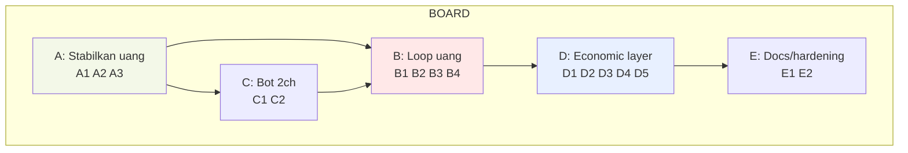
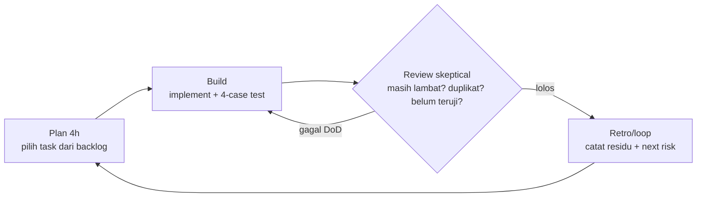
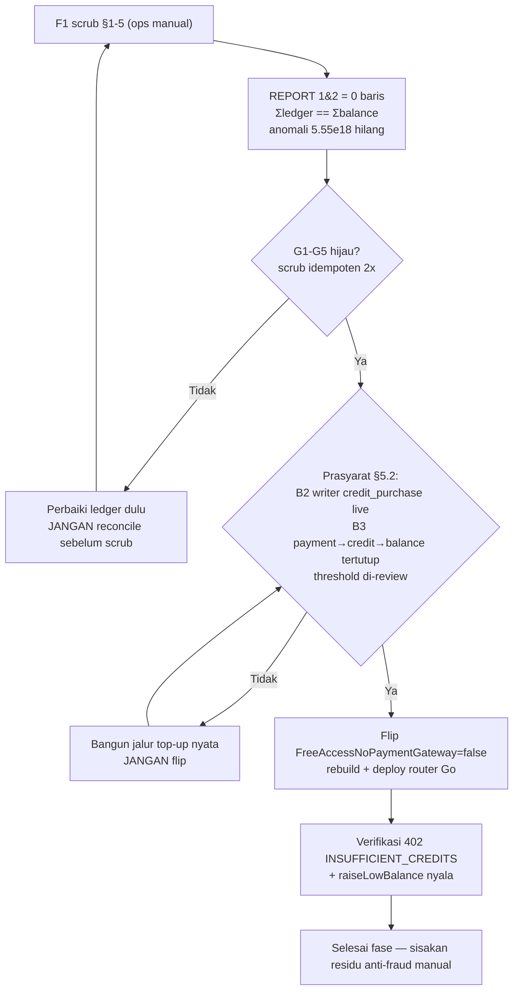

# FR-PLAN-PM — fudrouter Fase Perencanaan (PM + BI)

> Status: RENCANA (phase planning). HARD GATE: tidak ada perubahan kode repo.
> Ground truth: `local://fr-plan-brief.md` + repo `ssh://dwizzy/~/fudrouter` (dibaca langsung).
> Semua klaim rujuk `path:line` yang dibaca sendiri. [INFERENCE] dipakai hanya untuk hal yang tidak tertulis di repo.

---

## 0. Ringkasan eksekusi

fudrouter sudah **bukan produk MVP**: audit 100/100 (`docs/audit/SCORE.md`), data plane Go + control plane React 2-plane, billing integer `math/big` tanpa float, entitlement 1-key/3-IP/5-concurrency, bots core murni. Yang tersisa bukan "membangun dari nol" melainkan **menutup loop uang** (kriteria #9) dan **menghidupkan economic layer yang sudah dikodekan di branch `feat/economic-layer`**.

Temuan kunci yang mengubah prioritas (dibaca langsung):

1. **`reconcileAll` tidak tahan overflow bigint** — `billing.ts` cast `SUM(bigint)::bigint`; satu akun korup ($5.55e18) menggagalkan seluruh job `billing_aggregation` (`packages/platform/server/billing.ts:275-290`). Inilah sebab gate F1 (scrub) harus jalan DULU.
2. **Tidak ada writer `credit_purchase` produksi ril** — `postLedger` (`billing.ts:133-135`) hanya dipanggil jalur `usage_charge` (debit). `pages.mjs` add-credit + `admin.mjs` `/billing/credit` adalah *placeholder manual tanpa ceiling* yang justru menciptakan korupsi. Flip `FreeAccessNoPaymentGateway=false` (`backend/go/internal/store/limits.go:81`) tanpa jalur kredit = semua akun mati saat saldo 0.
3. **Bot payment lebih telanjang dari yang tertulis di brief.** Decision core `bots.ts` (147 ln) + `payments.ts` (QRIS/grant) SUDAH ADA; tapi *thin adapter I/O* untuk **Discord payment bot (`discord-bot.ts`) DAN Telegram (`telegram-bot.ts`) keduanya TIDAK ADA** — diverifikasi: `head` kedua file `No such file`. Yang ada di Discord hanyalah `discord.mjs` `joinFudcourt` (guild-membership OAuth, bukan payment command). Jadi kriteria #10 butuh **dua** adapter, bukan satu.
4. **Economic layer mayoritas sudah terkode, belum aktif** — migrasi 0033/0034 terpasang, `checkFrsubsQuota` (`proxy/budget.go`) sudah implement, writer sudah emit kolom ekonomis. Yang belum: 0035 masih gated, `provider_cost_rule` belum backfill, markup belum nyala, belum ada subscription frsubs aktif, prefix frcheap off. Tidak boleh ditulis ulang (kriteria #4).

**Fokus fase ini**: (A) stabilkan keterlacakan uang → (B) tutup loop `payment → credit_purchase → balance_micro` → (C) hidupkan bot payment 2 channel → (D) aktivasi economic layer → (E) dokumentasi. Urutan ini adalah **dependency chain**, bukan daftar bebas.

---

## 1. Breakdown: 13 kriteria → subgoals → objektif → task

Tiap task = **satu kalimat hasil** + file utama (atau `baru`) + rujukan `#N`.
Yang sudah ada ditandai **`SUDAH ADA — verifikasi saja`** dan *tidak* dibuatkan task implementasi (kriteria #4).

### Epic A — Stabilkan keterlacakan uang (bilangan bulat, no-float)
*Subgoals:* akhiri korupsi saldo; buat rekonstruksi tahan overflow; hentikan placeholder tanpa batas.

| ID | Task (hasil) | File utama | Kriteria |
|---|---|---|---|
| **A1** | **SUDAH ADA — verifikasi/eksekusi saja**: scrub 2 baris `credit_purchase` korup ($5.55e18) di staging lalu produksi, idempoten 2×, hingga G1–G5 hijau. | `ops/scrub-balance-anomaly.sql` + `docs/specs/2026-11-08-F1-balance-runbook.md` | #6, #9 |
| **A2** | `reconcileAll` dibuat tahan overflow (`numeric(40,0)` guard atau tangkap-error-lanjut-akun) supaya satu akun korup tidak menggagalkan seluruh batch. | `packages/platform/server/billing.ts` (reconcileAll, ~L275-290) | #6, #9 |
| **A3** | `pages.mjs` add-credit dan `admin.mjs` `/billing/credit` diberi **ceiling/guard** (batas atas implausible + audit + hanya admin), menghentikan sumber placeholder `5555555555555`. | `apps/web/server/pages.mjs` (credits/add), `apps/web/server/admin.mjs` (/billing/credit, MANUAL_LEDGER_TYPES) | #6, #11 |

### Epic B — Tutup loop uang (payment gateway + writer + flip)
*Subgoals:* jalur top-up nyata; siklus `payment→credit_purchase→balance_micro` tertutup; gerbang saldo nyala aman.

| ID | Task | File utama | Kriteria |
|---|---|---|---|
| **B1** | **Adapter/interface gateway** didefinisikan dulu (kontrak: create-payment, callback/verify, idempotensi), concrete gateway kedua — tanpa memilih vendor dini. | `baru`: `packages/platform/server/gateway.ts` (+ ADR-0008) | #9, #12 |
| **B2** | **Writer `credit_purchase` produksi ril**: konfirmasi pembayaran memanggil `postLedger(type='credit_purchase', amountMicro bigint)` dengan `idempotency_key = purchase:<ref>`. | `packages/platform/server/billing.ts` (postLedger sudah dukung type) + handler pembayaran baru | #9 |
| **B3** | **Webhook pembayaran + tutup loop tertutup**: `payment` (status) → konfirmasi → `credit_purchase` → update `balance_micro`, HMAC-verif + idempotent, audit trail lengkap. | `packages/platform/server/webhooks.ts` (pola `deliverWebhook`) + `payments.ts` | #9, #11 |
| **B4** | **Flip `FreeAccessNoPaymentGateway=false`** hanya setelah A1 hijau DAN B2/B3 live, lalu rebuild+deploy router Go. | `backend/go/internal/store/limits.go:81` | #9 |

### Epic C — Bot payment + info (2 channel)
*Subgoals:* Decision core ada; tinggal thin adapter I/O — SAMA persis untuk dua channel, tanpa duplikasi logika.

| ID | Task | File utama | Kriteria |
|---|---|---|---|
| **C1** | **Telegram adapter**: webhook/command → panggil `bots.ts` (planLines/paymentPrompt/adminApprovalPrompt/decideClaim) → render reply; juga warn (`warningText`) + marketplace. | `baru`: `apps/web/server/lib/telegram-bot.ts` | #10, #4, #2 |
| **C2** | **Discord payment adapter**: sambungkan command Discord ke `bots.ts` (saat ini `discord.mjs` hanya `joinFudcourt` guild-join, BUKAN payment bot). | `baru`: `apps/web/server/lib/discord-bot.ts` | #10, #4, #2 |

> `bots.ts` + `payments.ts` **SUDAH ADA** (murni, 4-case test) — C1/C2 *tidak* menulis ulang logika keputusan, hanya transport.

### Epic D — Aktivasi economic layer (bukan menulis ulang)
*Subgoals:* hidupkan yang sudah terkode; isi data harga pokok; markup jujur; kuota frsubs live.

| ID | Task | File utama | Kriteria |
|---|---|---|---|
| **D1** | **Buka gate 0035** (hapus `-- gated:` di satu commit yang sama dengan writer cutover) setelah verifikasi writer sudah emit bucket/basis. | `backend/go/migrations/0035_economic_enforce.sql` + `ops/migrate.sh` (gate L62-65) | #2, #6, #1 |
| **D2** | **Backfill `provider_cost_rule`** top-N provider frpayg aktif (F3); target ≥80% request berbayar 30d ber-`cost_basis='provider'`. | tabel `provider_cost_rule` (0034) + script backfill | #8, #13 |
| **D3** | **Aktifkan markup frpayg** (markup>1.0) hanya setelah D2; 0 violation `markup_basis_check`. | `bucket_margin` + `proxy/lifecycle.go` buildRow | #13 |
| **D4** | **SUDAH ADA (kode) — verifikasi/aktivasi saja**: kuota frsubs 5h/7d live (fail-closed DB fallback), butuh ≥1 subscription frsubs aktif + injection test counter-miss. | `backend/go/internal/proxy/budget.go` (checkFrsubsQuota) | #8, #6 |
| **D5** | **Prefix `frcheap/` (K11)** — ditunda; go/no-go: ≥1 sub frcheap terjual + `acquisition='farmed'` coverage ≥X + invalid<0.10 + breaker `θ_rate_limited=0.02`. | resolver supply guard `provider_model_supply` | #8, #13 |

### Epic E — Dokumentasi & hardening
| ID | Task | File utama | Kriteria |
|---|---|---|---|
| **E1** | **ADR pemilihan gateway + alur flip flag** (keputusan tidak mengambang; satu sumber kebenaran kontrak gateway). | `baru`: `docs/decisions/ADR-0008-*.md` | #5, #12 |
| **E2** | **Runbook go/no-go flip flag** diperluas ke prasyarat fungsional §5.2 (sudah ada A1 runbook; tambah section gateway+writer). | `docs/specs/2026-11-08-F1-balance-runbook.md` | #5, #12 |

### Kriteria yang SUDAH tercapai (tidak dibuatkan task — kriteria #4)
- **#1 kode rapi / #3 app ringan / #7 cepat / #12 best practices**: audit 100/100, code-quality 5/5, perf 5/5, 31/31 test, 334kB/106kB-gzip (`docs/audit/SCORE.md`). *Verifikasi ulang di tiap sentuhan hot path, bukan task baru.*
- **#8 routing baik**: strategi routing, circuit breaker, failover, health probe per-family SUDAH ADA (`backend/go/internal/routing/select.go`). Supply-guard routing masuk ke D2/D5 (data, bukan logika baru).
- **#11 secure (postur umum)**: secret rotation, SSRF, header, JSON error, limiter, changeRole dominance SUDAH ADA. Sisa spesifik = A3 (ceiling input) + B3 (HMAC webhook).
- **Entitlement 1-key/3-IP/5-concurrency**: SUDAH ADA (`backend/go/internal/entitlement/guard.go`). Tidak ada task.

---

## 2. Kanban board

Kolom: **Backlog → Sprint → Dev → QA → TechLead**. WIP limit per kolom. Semua 16 task.

```mermaid
flowchart LR
  subgraph BL["Backlog (∞)"]
    direction TB
    b1["B1 gateway adapter"]
    b2["B3 payment webhook"]
    b3["B4 flip flag"]
    b4["C1 telegram adapter"]
    b5["C2 discord adapter"]
    b6["D2 backfill provider_cost_rule"]
    b7["D3 markup frpayg"]
    b8["D4 quota frsubs live"]
    b9["D5 prefix frcheap"]
    b10["E1 ADR gateway"]
    b11["E2 runbook flip"]
  end
  subgraph SP["Sprint (WIP 6)"]
    direction TB
    s1["A1 scrub eksekusi"]
    s2["A2 reconcileAll overflow"]
    s3["A3 add-credit ceiling"]
    s4["B2 writer credit_purchase"]
    s5["D1 buka gate 0035"]
  end
  subgraph DV["Dev (WIP 4)"]
    direction TB
    d1["A2 reconcileAll overflow"]
    d2["A3 add-credit ceiling"]
    d3["B2 writer credit_purchase"]
  end
  subgraph QA["QA (WIP 2)"]
    direction TB
    q1["A1 scrub 2× idempoten"]
    q2["A2 reconcileAll overflow"]
  end
  subgraph TL["TechLead (WIP 2)"]
    direction TB
    t1["A1 scrub go/no-go approve"]
  end
  BL --> SP --> DV --> QA --> TL
```

> Catatan WIP: kanban di atas adalah *snapshot* contoh satu titik waktu (beberapa task tampil di >1 kolom untuk menggambarkan alur pull). Kebijakan sesungguhnya: Task BARU hanya boleh ditarik (pull), bukan didorong; WIP Kolom = `Backlog ∞ · Sprint 6 · Dev 4 · QA 2 · TechLead 2`; dimulainya **B4 (flip flag)** dan **D3 (markup)** diblokir oleh gate upstream (voirjal decision flow §5).

**Sequence yang tidak tumpang-tindih** (dependency): `A1 → A2 → A3` (prasyarat) ⇒ `B1/B2 → B3 → B4` (flip terakhir) ⇒ `C1/C2` bisa paralel dengan B ⇒ `D1 → D2 → D3` (markup hanya setelah backfill) — `D4` paralel, `D5` paling akhir (go/no-go K11). `E1/E2` menyertai titik keputusan.

---

## 3. User persona

| Persona | Peran | Goal | Pain point | Teknis-savvy |
|---|---|---|---|---|
| **Diva (ops/finance admin)** | Settle QRIS + verifikasi pembayaran + farm trigger | Tutup buku harian tanpa typo; tahu Σledger==Σbalance. | 3 kelas tiket manual = SPOF; placeholder saldo lah yang menciptakan $5.5T. | Sedang (SQL admin, bukan dev) |
| **Raka (developer/end member)** | Beli waktu (1d–28d) + pakai API key untuk build agent | 1 key, top-up cepat, dipakai tanpa ribet. | Tidak ada jalur top-up otomatis; setelah flip saldo 0 = mati total. | Tinggi (dev API) |
| **Sari (BI/analis)** | Atribusi biaya jujur per bucket (frcheap/frpayg/frsus) | Tahu COGS vs marginal vs margin asli per baris. | `provider_cost_micro=cost` = kebohongan; `provider_cost_rule` kosong → markup imajiner. | Sedang (SQL/dashboard) |
| **Bayu (devops/on-call)** | Deploy flip flag aman + rekonstruksi ledger | Flip tanpa outage; job aggregation 0 error. | `reconcileAll` overflow menggagalkan seluruh batch diam-diam. | Tinggi |
| **Zupaxx (owner/admin approval)** | Approve claim "Yes/No" via bot | Lihat bukti + satu tombol publish key. | Bot Telegram belum ada; Discord hanya guild-join, bukan payment. | Sedang |

---

## 4. Pain point → masalah sebenarnya (symptom vs root cause) → fitur → kriteria

| # | Symptom (yang terlihat) | Root cause (masalah sebenarnya) | Fitur penyelesaian | Kriteria |
|---|---|---|---|---|
| 1 | Akun jadi $5.5 triliun, `billing_aggregation` error tiap jam | Input placeholder `5555555555555` lewat `pages.mjs` add-credit **tanpa ceiling** + `reconcileAll` cast `::bigint` overflow | A1 scrub (ada) + A2 overflow-guard + A3 ceiling/guard | #6, #9, #11 |
| 2 | "Saldo nol" bukan; balance gate mati (`FreeAccessNoPaymentGateway=true`) | Tidak ada writer `credit_purchase` produksi ril; loop `payment→credit→balance` belum tertutup | B2 writer + B3 webhook loop + B4 flip | #9 |
| 3 | Member tak bisa bayar dari Telegram; Discord "bot" hanya auto-join guild | Decision core ada tapi **adapter I/O payment tidak ada** (keduanya) | C1 telegram-bot + C2 discord-bot (reuse `bots.ts`) | #10 |
| 4 | "Markup" dihitung di atas retail yang imajiner; farm dianggap gratis tanpa bukti | `provider_cost_micro = cost` (lifecycle.go:1312) + `provider_cost_rule` kosong | D1 buka 0035 CHECK + D2 backfill + D3 markup jujur | #8, #1, #13 |
| 5 | Satu operator = SPOF (verifikasi QRIS + farming manual + triase) | 3 kelas tiket manual tanpa delegasi/otomasi | B1/B3 (gateway kurangi verifikasi manual); farm tetap manual *by design* | #12, #13 |

> Point 5 sengaja **parsial**: farming tetap manual-trigger (`farmpolicy.go` "manual-trigger by design") dan anti-fraud screenshot tetap butuh manusia. Tidak ada fitur yang menghilangkan SPOF sepenuhnya dalam fase ini — diungkap jujur di §5.

---

## 5. Validasi (honest "masalah berikutnya yang tersisa")

Untuk tiap fitur utama: jika X diatasi, apa yang MASIH tersisa?

| Fitur diatasi | Masalah berikutnya yang tersisa (jujur) |
|---|---|
| A1+A2+A3 (scrub & guard) | Tidak otomatis menghasilkan **ujang masuk**: balance yang bersih tetap tak terisi sampai ada top-up nyata → butuh B2/B3. |
| B2+B3+B4 (top-up & flip live) | Operator masih harus **verifikasi anti-fraud manual** (screenshot/ref) dan **farm tetap manual**; juga belum ada dashboard **admin payment** yang lengkap untuk rekonsiliasi settlement. |
| C1+C2 (bot 2 channel live) | Approval flow bergantung pada **satu admin** `@zupaxx`; tidak ada eskalasi/fallback jika admin offline → antrean claim mandek. |
| D1+D2+D3 (markup jujur nyala) | **COGS frcheap masih estimasi** (churn tak terukur, `cogs_estimated_micro` belum terisi, 25.997 unknown/1.476 invalid) → margin frcheap tetap perkiraan sampai operator men-triage credential. |
| D4 (kuota frsubs live) | **Harga pokok FRSUBS flat** (`provider_plan_cost_micro_30d`) masih placeholder sampai operator mengisi angka plan nyata → floor anti-arbitrase masih lemah. |
| D5 (prefix frcheap) | Publikasi daftar model farm = daftar target drain gratis; butuh **coverage credential farmed + invalid-rate + breaker** dulu (go/no-go K11). |

**Kesimpulan validasi**: tidak ada langkah tunggal yang "selesai"; setiap fase menutup satu loop dan menyingkap loop berikutnya. Jujur berarti: kita tidak mengklaim "payment selesai" sampai §5.2 F1 dan anti-fraud punya jalur, dan tidak mengklaim "economic layer selesai" sampai COGS riil terisi (bukan passthrough markup=1.0 selamanya).

---

## 6. Backlog prioritas (RICE)

Skala: Reach (R) 1–10, Impact (I) 1–10, Confidence (C) 40–100%, Effort (E) story-point 1–10. `Score = R×I×C / E`. Prioritas memperhitungkan **dependency** (B4 must after B2/B3; D3 must after D2).

| Rank | ID | Task | R | I | C | E | Score | Tag |
|---|---|---|---|---|---|---|---|---|
| 1 | A1 | Scrub saldo (runbook ada) | 10 | 10 | 90% | 1 | 90.0 | **Quick-win** |
| 2 | A2 | reconcileAll overflow-guard | 10 | 9 | 95% | 2 | 42.8 | **Quick-win** |
| 3 | A3 | add-credit ceiling/guard | 8 | 9 | 95% | 2 | 34.2 | **Quick-win** |
| 4 | B2 | writer credit_purchase ril | 9 | 10 | 85% | 4 | 19.1 | **Strategic** |
| 5 | C1 | Telegram adapter | 8 | 7 | 80% | 3 | 14.9 | Quick-win (lever) |
| 6 | C2 | Discord payment adapter | 7 | 7 | 80% | 3 | 13.1 | Quick-win (lever) |
| 7 | B3 | payment webhook loop tertutup | 9 | 9 | 70% | 5 | 11.3 | **Strategic** |
| 8 | B1 | gateway adapter interface | 9 | 8 | 60% | 4 | 10.8 | **Strategic** |
| 9 | D1 | buka gate 0035 | 7 | 8 | 90% | 3 | 16.8 | Quick-win (verifikasi) |
| 10 | D2 | backfill provider_cost_rule | 7 | 8 | 55% | 6 | 5.1 | **Strategic** |
| 11 | D4 | kuota frsubs live | 5 | 7 | 85% | 2 | 14.9 | Verifikasi |
| 12 | D3 | markup frpayg aktif | 7 | 8 | 60% | 4 | 8.4 | **Strategic** |
| 13 | B4 | flip flag | 10 | 10 | 70% | 1 | 70.0 | **Strategic (gated)** |
| 14 | D5 | prefix frcheap | 5 | 6 | 45% | 5 | 2.7 | Deferred |
| 15 | E1 | ADR gateway | 5 | 5 | 90% | 1 | 22.5 | Quick-win |
| 16 | E2 | runbook flip | 5 | 5 | 90% | 1 | 22.5 | Quick-win |

> **Urutan sprint yang benar** mempertimbangkan bahwa B4 skornya tinggi tapi **diblokir gate**; urutan eksekusi = A1→A2→A3, lalu B1/B2→B3, lalu C1/C2 (paralel), lalu D1→D2→D3 (D4 paralel), B4 flip, D5 deferred. Quick-win dulu untuk unblock, strategic di belakang untuk nilai.

---

## 7. Sprint plan timeline (blok 4 jam)

Tiap blok punya **deliverable + reviewer + definition-of-done**. Review mengikuti pola skeptical re-read (kriteria #5/#6/#12: jangan pernah menelan hasil).

### Sprint loop

### Sprint 1 — Fondasi uang (4 jam)
| Blok | Deliverable | Reviewer | Definition of Done |
|---|---|---|---|
| 1.1 (4h) | A1 scrub anomali di **staging** → REPORT 1&2 = 0 baris; A2 `reconcileAll` overflow-guard terpasang; A3 ceiling add-credit + test 4-case | TechLead | G1–G5 hijau 2× idempoten (scrub 2× = 0 baris berubah); `reconcileAll` tidak lagi `bigint out of range`; add-credit menolak >1e12 µUSD dengan 400 + audit |

### Sprint 2 — Writer + webhook loop uang (4 jam)
| Blok | Deliverable | Reviewer | Definition of Done |
|---|---|---|---|
| 2.1 (4h) | B1 interface `gateway.ts` (kontrak create/verify/callback, idempotent); B2 handler `credit_purchase` → `postLedger` bigint; uji murni 4-case | TechLead + QA | Interface tidak memilih vendor; `postLedger(type='credit_purchase')` ber-idempotensi `purchase:<ref>`; audit trail lengkap |

### Sprint 3 — Webhook tertutup + flip gate (4 jam)
| Blok | Deliverable | Reviewer | Definition of Done |
|---|---|---|---|
| 3.1 (4h) | B3 payment webhook (HMAC, idempotent, `payment→credit→balance`); skenario ujung-ke-ujung di staging | QA + DevilAdvocate | Loop tertutup teruji 1 pembayaran = 1 `credit_purchase` = 1 `balance_micro` naik; replay webhook = no double-post; **B4 TIDAK diflip** sampai §5.1+§5.2 hijau |

### Sprint 4 — Bots (2 channel, paralel) (4 jam)
| Blok | Deliverable | Reviewer | Definition of Done |
|---|---|---|---|
| 4.1 (4h) | C1 telegram-bot.ts + C2 discord-bot.ts (command→`bots.ts`→reply; warn+marketplace) | TechLead + QA | Kedua adapter reuse `bots.ts` (0 duplikasi logika); 4-case test per adapter; pesan harga identik antar channel |

### Sprint 5 — Economic layer: buka gate + backfill (4 jam)
| Blok | Deliverable | Reviewer | Definition of Done |
|---|---|---|---|
| 5.1 (4h) | D1 buka gate 0035 (satu commit dengan verifikasi writer); D2 backfill `provider_cost_rule` top-N frpayg; D4 kuota frsubs live (injection test) | BI + Pessimist | 0 `check_violation` di CI; cakupan `cost_basis='provider'` ≥80% atau frpayg passthrough markup=1.0 tetap aman; counter-miss→DB fail-closed teruji |

### Sprint 6 — Markup + dokumentasi keputusan (4 jam)
| Blok | Deliverable | Reviewer | Definition of Done |
|---|---|---|---|
| 6.1 (4h) | D3 markup frpayg nyala (setelah D2); E1 ADR gateway; E2 runbook flip | TechLead + semua | `billing_basis='provider'` baris >0 dengan 0 violation `markup_basis_check`; ADR + runbook direview tanpa keputusan mengambang |

### Sprint 7 — Retro + go/no-go flip (4 jam)
| Blok | Deliverable | Reviewer | Definition of Done |
|---|---|---|---|
| 7.1 (4h) | B4 flip flag + smoke 402 `INSUFFICIENT_CREDITS`/`raiseLowBalance`; retrospective length | TechLead + DevilAdvocate + Pessimist | Seluruh §5.1 hijau DAN §5.2 terpenuhi → flip + rebuild + deploy; smoke live; catat residu §5 (anti-fraud manual, SPOF, COGS estimasi) |

> **D5 (prefix frcheap)** sengaja di luar 7 sprint (deferred strategic) — butuh go/no-go K11 yang datanya belum ada (subscription frcheap terjual, coverage farmed, breaker).

---

## Lampiran — decision flow (flip flag go/no-go)

---

*Rencana ini ditulis tanpa menyentuh kode repo. Tahap berikutnya (bukan di file ini) adalah judge brutal oleh Devil Advocate + Pessimist sebelum implementasi apa pun.*