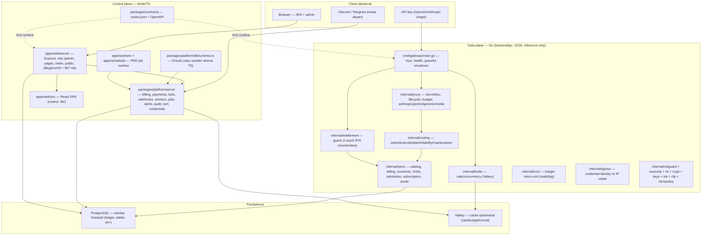
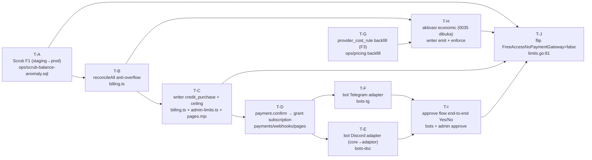

# FR-PLAN-TL — Tech Lead: Arsitektur & Decision Flow (13 Kriteria)

Fase perencanaan. HARD GATE terpenuhi: tidak ada kode repo yang diubah. Semua `path:line` dibaca langsung via `ssh://dwizzy/~/fudrouter/...`. Rujukan status: HEAD `f718087`, branch `feat/economic-layer`.

---

## 1. Arsitektur Saat Ini (ringkas)

### Package kunci (satu baris per package)

**Data plane Go (`backend/go`):**
- `internal/proxy` — seluruh permukaan HTTP `/v1/*` + lifecycle (2443 ln `lifecycle.go`), bel listrik & 402/404 failover, ledger writer.
- `internal/store` — akses DB (catalog 1157 ln, billing, economic, limits, admission, subscription, quota, pricing, virtual, combo, logs, injection).
- `internal/routing` — 8 strategi seleksi (balanced/lowest_cost/lowest_latency/highest_reliability/weighted/round_robin/random/smart) + circuit breaker + failover.
- `internal/entitlement` — guard aturan member (1 key, ≤3 IP, ≤5 concurrency, jendela subscription).
- `internal/limits` — rate/concurrency counter via Valkey (degrade open), beda dari entitlement (degrade closed).
- `internal/cost` — aritmetika uang integer mikro-unit, `math/big` anti-overflow.
- `internal/egress` — memisah identitas credential dari rotasi IP anonim (direct/ipv6_rotate/sticky_own/pool).
- `internal/economic` (di `store/economic*.go`, `store/quota.go`) — bucket, basis, provider cost tiga-nilai, kuota rolling frsubs.
- `internal/farmpolicy` — keputusan kapan run farming signup (pure, manual-trigger by design).
- `internal/{netguard,sourceip,vk,crypt,keys,ids,cfp}` — SSRF dial guard, source affinity, Valkey client, AES-256-GCM, parse key, prefixed uuidv7, protokol CFP.

**Control plane Node/TS:**
- `packages/platform/server/billing.ts` — credit_ledger + reconcileAll (ledger = record, balance_micro = cache).
- `packages/platform/server/payments.ts` — PLANS frozen (5 paket IDR), QRIS dinamis (tag 54 + CRC), grant rule murni.
- `packages/platform/server/bots.ts` — core bot murni/unit-testable (plan lines, payment prompt, approve, marketplace, warning) — transport dipisah.
- `packages/platform/server/webhooks.ts` — dispatch + delivery durable, signature HMAC, SSRF per-delivery.
- `packages/platform/server/workers.ts` (2004 ln) — job fleet idempotent (rollup, aggregation, catalog, alert).
- `packages/platform/server/{jobs,scheduler,alerts,audit,credentials,provider-credentials,ssrf,vk,id,admin-limits,settings}.ts` — queue, scheduling, eval alert, audit merah, envelope AES, SSRF, Valkey, id prefix.
- `packages/platform/db/schema.ts` — satu sumber definisi tabel (Drizzle).
- `apps/web/server/{admin,pages,index,public,playground}.mjs` — Express kontrol/management (untyped), 187 operasi management.
- `apps/web/server/lib/platform-ts.mjs` — bridge konvergensi shared-TS (server .mjs → `@fudrouter/platform/*.ts`).
- `packages/contracts/` — routes.json (lock surface) + OpenAPI inference/management.
- `apps/web/src/` — React SPA. `apps/{workers,scheduler}` — entrypoint PM2 node untuk job/schedule.

---

## 2. Decision flow — 13 kriteria

Untuk tiap kriteria: **status** (SUDAH/KURANG/ABSEN), bukti `path:line`, gap, keputusan arsitektur (nama package/file yang disentuh, bukan kode).

### K1 — Kode rapi
- **Status:** SUDAH (mayoritas). Bukti: `backend/go/internal/*` terpilah per tanggung jawab; module TS murni dikomentari konteks (mis. `packages/platform/server/billing.ts:1-30`, `payments.ts:1-20`); audit code-quality 5/5 (`docs/audit/SCORE.md`).
- **Gap:** file mati `backend/go/internal/store/store.go.orig` (319 ln; hanya beda `MaxConns()` yang sudah pindah ke `store.go` 330 ln). Duplikasi aturan yang terdokumentasi belum ditutup (`packages/platform/publish.ts` header menyebut dua implementasi gate publish).
- **Keputusan:** hapus `store.go.orig` (dead weight, kriteria #4). Jadikan "satu sumber per konsep" (§3) sebagai gate approve; setiap PR yang menambah salinan diputus DISAPPROVE.

### K2 — Terstruktur
- **Status:** SUDAH. Bukti: monorepo role-first (`docs/decisions/0001-monorepo-layout-role-first.md`), `backend/go/{cmd,internal,migrations}`, `packages/{platform,contracts}`, `apps/{web,workers,scheduler}`. Migrasi bernama berurutan `0000..0035`.
- **Gap:** server Express masih monolitik `.mjs` (`admin.mjs` ~2742 ln, `pages.mjs` ~1746 ln). ADR-0005 mengakui route tidak dalam router table.
- **Keputusan:** pertahankan layout; TIDAK restruktur besar (kriteria #4). Saat menyentuh boundary, rute baru masuk file server yang benar; logika wajib di `packages/platform/server`. Tidak memecah `.mjs` lama tanpa kebutuhan — biaya restruktur > nilai.

### K3 — App ringan
- **Status:** SUDAH. Bukti: Go binary inference-only (tidak ada admin handler di Go, `docs/architecture/2026-10-10-architecture-inventory.md` §3.1); Valkey opsional (`main.go:119-126` komentar `vk.NewFromEnv` disable-bersih); SPA bundle 334kB/106kB-gzip (`docs/audit/SCORE.md`); hitungan cache ≥60% (owner rule 19).
- **Gap:** minor — bot runtime baru (jika jadi proses permanen) jangan menambah bobot data plane.
- **Keputusan:** bot = proses/adapter di control plane (bukan di Go). Go tetap satu tanggung jawab: inference. Node memegang I/O bot.

### K4 — Tidak redundant
- **Status:** KURANG. Bukti konvergensi berjalan: `apps/web/server/lib/platform-ts.mjs` (bridge shared-TS menggantikan salinan SSRF/creds/id/rbac/publish), `packages/platform/rbac.ts` (ROLE_CAPS satu sumber), `packages/platform/publish.ts` (gate publish satu sumber). Sisa: `store.go.orig`, gate publish masih dua implementasi (TS + SQL `catalog.go`), tiga tempat `LEDGER_TYPES` di `admin.mjs:518,545` vs `billing.ts:35`.
- **Gap:** potensi drift harga plan (kamus `PLANS` di `payments.ts` vs CHECK `0025` vs UI), TIDAK ada writer `credit_purchase` produksi (add-credit admin redundan/raw SQL di `pages.mjs:526`).
- **Keputusan:** terapkan §3 (5 aturan). Sumber kebenaran tunggal: `packages/platform/server/payments.ts` untuk plan/harga; `billing.ts` untuk ledger type; `schema.ts` untuk tabel. Migrasikan `admin.mjs` manual-ledger menuju `billing.ts` `postLedger`.

### K5 — Terdokumentasi
- **Status:** SUDAH. Bukti: `docs/specs` (9 file), `docs/audit` (12 kategori + SCORE 100/100), `docs/decisions` (ADR 0001–0007), `docs/architecture`, `docs/changelog`, `packages/contracts/README.md`.
- **Gap:** rollout economic layer baru F0–F2 terdokumentasi (`2026-11-08-economic-layer-rollout.md`); F3–F6 (backfill harga pokok, markup live, kuota live, prefix publik) belum ada plan-nya.
- **Keputusan:** tiap task baru wajib menyentuh: ADR (jika keputusan arsitektur) + spec/runbook (jika menyentuh uang) + changelog. Payment gateway & bot wajib punya runbook operator mirroring `F1-balance-runbook.md`.

### K6 — Tidak ada bug
- **Status:** KURANG. Bug terverifikasi: (a) `reconcileAll` overflow bigint — gagalkan seluruh job jika satu akun melampaui int64, `packages/platform/server/billing.ts:275` (`::bigint`), mematikan `billing_aggregation` semalaman; (b) add-credit tanpa ceiling (`apps/web/server/pages.mjs:526`) — menyuntik placeholder `5555555555555`; (c) dua baris `credit_ledger` korup `5.55e18` µUSD (runbook `docs/specs/2026-11-08-F1-balance-runbook.md`).
- **Gap:** tidak ada writer `credit_purchase` produksi; `payment` table 0 baris.
- **Keputusan:** (1) buat `reconcileAll` toleran overflow (sum di `numeric`, cast tersembunyi/out-of-range disisihkan, bukan gagalkan armada) di `packages/platform/server/billing.ts`; (2) pindah add-credit dari raw SQL ke `postLedger` + ceiling (`admin-limits.ts` `MAX_*`); (3) scrub F1 sebagai prasyarat mutlak sebelum flip flag.

### K7 — Cepat
- **Status:** SUDAH. Bukti: cache in-process 60s (`store/limits.go` hardLimits, `economic_resolve.go` ResolveBucket cache 60s), hot path O(1) allocation-light (`entitlement/guard.go:1-30`), `reconcileAll` set-based satu round-trip (`billing.ts:257-277`), `cost` math/big hanya pas request, staging scan DDL `idempotent`.
- **Gap:** tidak ada. Gate: perubahan hot path tidak boleh menambah per-request Postgres round-trip.
- **Keputusan:** semua gate baru (bucket, kuota) memakai pola cache 60s yang sudah ada; tidak ada query per-request baru.

### K8 — Routing baik
- **Status:** SUDAH. Bukti: `internal/routing/select.go:33-41` 8 strategi, `select.go:361-459` scoring + partition, circuit breaker + failover (`reliability.go`, `maintenance.go`), health probe per-family (`proxy/health.go`), farm policy (`farmpolicy.go`).
- **Gap:** pricing/cost routing economic tergantung `provider_cost_rule` yang belum di-backfill (F3). `smart` masih = `balanced` (`select.go:67`).
- **Keputusan:** tidak ada perubahan strategi. Backfill `provider_cost_rule` untuk top-N provider aktif (bukan 728 sekaligus — desain §2 non-goal c) sebagai task terpisah; `smart` tetap deferred (P2 own learned scoring).

### K9 — Payment gateway fast (otomatis)
- **Status:** ABSEN. Bukti: `FreeAccessNoPaymentGateway=true` (`backend/go/internal/store/limits.go:81`); balance gate nonaktif (`proxy/budget.go:63`). Yang ada: QRIS dinamis + verifikasi admin manual (`payments.ts` `qrisFor`, `resolveGrant`; `pages.mjs:625-689` checkout/claim; `payment` table belum berisi).
- **Gap:** (1) loop `payment → credit_purchase → balance_micro` belum tertutup (tidak ada writer `credit_purchase` produksi); (2) tanpa top-up nyata, flip `FreeAccessNoPaymentGateway=false` memblokir semua akun saat saldo habis; (3) `payment.status='confirmed'` belum ada writer yang men-trigger grant.
- **Keputusan:** minimal yang **valid untuk approve** = gerbang otomatis "QRIS dinamis + verifikasi operator" (bukan integrator gateway pihak ketiga penuh). Urutan arsitektur: (a) writer `credit_purchase` via `billing.ts` `postLedger` (idempoten `purchase:<id>`); (b) webhook/endpoint `payment.confirm` yang set `status='confirmed'` + memanggil grant rule → `subscription` row (`0025`); (c) ekstensi ke gateway otomatis nyata (midtrans/qris via API) di task terpisah. File: `packages/platform/server/{payments,billing,webhooks}.ts`, `apps/web/server/pages.mjs`, migrasi baru bila perlu.

### K10 — Telegram & Discord bot (payment + info)
- **Status:** KURANG (core ada, transport/telegram belum). Bukti: `packages/platform/server/bots.ts` (pure: `planLines`, `paymentPrompt`, `adminApprovalPrompt`, `decideClaim`, `marketplaceListing`, `warningText`) dan `payments.ts` (grant rule murni); adapter Discord hanya `joinFudcourt` (guild join) `apps/web/server/lib/discord.mjs`, **bukan** bot payment. **Telegram bot adapter ABSEN** (komentar `bots.ts:20` menyebut `discord-bot.ts`, `telegram-bot.ts` yang belum ada; OAuth telegram login ada `apps/web/server/index.mjs:465`).
- **Gap:** tidak ada runtime bot yang: (1) menerima command pilih plan → QR, (2) menerima bukti bayar, (3) menampilkan approve Yes/No ke admin, (4) Yes → grant + publish key.
- **Keputusan:** bangun adapter tipis `discord` + `telegram` di `packages/platform/server/bots-*.ts` yang hanya mengubah update platform → call ke `bots.ts` core + render reply (pola `publish.ts`/`publish-env.ts`). Core TIDAK diubah. Transport (SDK discord.js/grammY) wajib injektable agar core tetap unit-testable tanpa jaringan.

### K11 — Secure
- **Status:** SUDAH (mayoritas). Bukti: SSRF guard (`packages/platform/server/ssrf.ts`), envelope AES-256-GCM (`credentials.ts`, `0006`), RBAC (`rbac.ts`), IP guard + restrict (`0025`, `entitlement/guard.go`), injection (`store/injection.go`, `proxy/injection.go`), audit merah (`audit.ts`), idempotensi durable (`billing.ts` `postLedger`), signature webhook (`webhooks.ts`).
- **Gap:** add-credit tanpa ceiling = lubang (admin/placeholder menyuntik saldo triliunan). Webhook payment masa depan wajib verify signature + idempoten + SSRF.
- **Keputusan:** tiap jalur mutasi uang wajib: idempotensi key durable + ceiling + audit row. Gateway/webhook pembayaran wajib stempel HMAC + anti-replay (`webhooks.ts` sebagai pola acuan). Add-credit ceiling wajib di `admin-limits.ts`.

### K12 — Best practices industri
- **Status:** SUDAH. Bukti: contracts-first (`docs/decisions/0005-contracts-first.md`, `packages/contracts/`), append-only ledger + cache reconcilable (`billing.ts`), integer money no-float (`cost.go`, `billing.ts:70`), idempotent workers (`workers.ts` header), fail-closed pada spend/entitlement vs fail-open rate limiter (didokumentasi).
- **Gap:** tidak ada. Pertahankan.
- **Keputusan:** aproval mengikuti prinsip: uang = integer+ledger+idempoten; surface = terkunci kontrak; job = idempoten. Setiap pelanggaran = DISAPPROVE.

### K13 — Tujuan lainnya (aktivasi economic layer + gate payment hidup)
- **Status:** KURANG (branch siap, belum aktif). Bukti: `0033/0034` aditif terpasang, `0035` gated; `bucket`/`billing_basis`/`cost_basis`/`markup`/kuota di `store/economic*.go`, `quota.go`; `provider_cost_rule` belum backfill; `FreeAccessNoPaymentGateway` masih true.
- **Gap:** urutan aktifasi belum lengkap (F3–F6).
- **Keputusan:** critical path K13 → urutan F1 (scrub) → F2 (writer emit + `0035` dibuka) → **baru** K9 (loop pembayaran) → flip `FreeAccessNoPaymentGateway=false` terakhir. Tanpa loop pembayaran, flip flag = self-lockout masal (gap F1 #3).

---

## 3. Prinsip tidak-redundant (5 aturan konkret)

1. **Satu sumber kebenaran per konsep uang.** Plan/harga ⇨ `packages/platform/server/payments.ts` `PLANS` (bukan DB row, bukan UI); ledger type ⇨ `billing.ts` `LEDGER_TYPES`; skema ⇨ `db/schema.ts`. UI hanya render, tidak pernah memegang angka gate.
2. **Shared-TS wajib, bukan opsional.** Logika yang dipakai >1 permukaan (server `.mjs`, bot, workers, SPA guard) hidup di `packages/platform/server/*.ts` dan di-re-export lewat `apps/web/server/lib/platform-ts.mjs`. Salinan tangan di `.mjs` = DISAPPROVE (pola yang sudah menang: SSRF, rbac, publish, id, creds).
3. **Adaptor beda transport, core beda keputusan.** Bot Discord & Telegram hanya adaptor tipis; keputusan (plan, grant, approve, marketplace, warning) satu di `bots.ts`/`payments.ts`. Tidak boleh ada dua render harga (pola `marketplaceListing()`).
4. **Hapus yang mati saat disentuh.** `store.go.orig` (dead weight) dihapus; jangan sisakan alias/shim/re-export deprecated. Clean cutover: migrasi semua caller.
5. **Kontrak terkunci, bukan aspirasi.** Surface diverifikasi `packages/contracts/` (routes.json + OpenAPI); `publish.ts`/`catalog.go` didokumentasikan sebagai dua implementasi gate dan harus di-pin oleh test drift (bukan dihapus diam-diam). Dua implementasi yang sah harus punya tripwire test, bukan komentar.

---

## 4. Dependency & tahapan antar task

**3 critical path:**
1. **Scrub → reconcile safe → writer → payment loop → flip.** Uang tidak boleh hidup sebelum prasyarat beres. `A→B→C→D→(E/F→I)→J`.
2. **Backfill COGS → 0035 enforce → flip.** Economic tidak jujur tanpa `provider_cost_rule`; enforcement CHECK aktif hanya setelah writer emit. `A→B→H→J` (dengan `G` sebelum `H`).
3. **Flow pembayaran + bot sebelum flip.** Loop `payment → credit_purchase → balance` wajib tertutup sebelum `FreeAccessNoPaymentGateway=false`; kalau dibalik, semua akun self-lockout. `D→I→J`.

Catatan: `C` (writer + ceiling) tidak boleh digabung dengan `J` (flip). Scrub F1 (A) adalah prasyarat eksplisit `limits.go:81` (runbook yang sama).

---

## 5. Gate approval / disapprove (definisi-done teknis)

Tech Lead approve/disapprove per task dengan acceptance observable (bukan klaim).

### Definisi-done minimal (per requirement)
- **T-A (scrub):** REPORT scrub keluar tepat 2 baris korup & 1 akun drift (mirror runbook §3); `Σ ledger == Σ balance_micro`; anomali `5.55e18` hilang; dijalankan di staging dulu, rollback terdefinisi.
- **T-B (reconcile):** `reconcileAll` gagal-aman saat satu akun overflow (tidak menggagalkan armada); test kasus nilai >int64; set-based satu round-trip tetap.
- **T-C (writer+ceiling):** `credit_purchase` lewat `postLedger` (idempoten `purchase:<id>`, +audit row, mutasi atomic); ceiling tegak di `admin-limits.ts`; add-credit lama dihapus (clean cutover).
- **T-D (grant):** `payment.status='confirmed'` → `subscription` row idempoten (no double-grant); aksi gagal-tertutup pada amount mismatch/unknown plan (reuse `resolveGrant`); 0 double-publish.
- **T-E/T-F (bot):** adapter hanya I/O; core `bots.ts`/`payments.ts` tidak diubah; test unit core tetap hijau tanpa jaringan; kedua bot render `marketplaceListing()` yang sama.
- **T-I (approve e2e):** Yes → grant+publish; No → follow-up; short-payment Yes → tetap no-grant (fail-closed).
- **T-J (flip):** guru `FreeAccessNoPaymentGateway=false`; gate aktif; tidak ada akun sehat yang self-lockout (ada top-up nyata); observasi `charged>cost` naik hanya di COGS riil.
- **Umum:** uang integer+ledger+idempoten; surface terkunci `packages/contracts` (`npm run check` hijau); tsc 0 + test hijau + build/restart hijau.

### Penyebab DISAPPROVE
1. Ada salinan aturan/angka ganda (harga plan di >1 tempat tanpa source) — melanggar §3.
2. Mutasi uang tanpa idempotensi durable + audit row, atau lewat raw SQL di `.mjs` bukan `billing.ts`.
3. Flip `FreeAccessNoPaymentGateway=false` tanpa loop top-up nyata tertutup (self-lockout).
4. Perubahan hot path menambah per-request Postgres round-trip.
5. Bot adapter menyusupkan logika keputusan (bukan call ke core).
6. `reconcileAll` masih overflow saat satu akun melebihi int64.
7. Surface berubah tanpa regenerasi `packages/contracts` (contracts gate merah).
8. Dead weight / shim / alias / route deprecated yang ditinggal saat cutover.