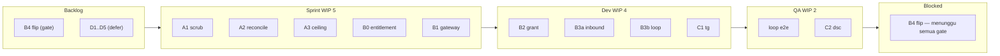

# FR-REVISED — Rencana fudrouter v2 (pasca-judge brutal)

Status: **REVISED** setelah verdict REVISE dari DevilJudge + PessimistJudge. Setiap temuan P0/P1 di bawah punya keputusan eksplisit. Tidak ada implementasi sebelum tech lead APPROVE.

Sumber: `fr-plan-brief.md` (ground truth), `fr-plan-pm.md` + `fr-plan-tl.md` (rencana v1), `fr-judge-devil.md` + `fr-judge-pessimist.md` (temuan).

---

## 0. Resolusi temuan judge (P0/P1 → keputusan)

| # | Temuan (sumber) | Keputusan revisi |
|---|---|---|
| S1/P1.2 | `reconcileAll` guard `numeric` tak selesaikan overflow: total 1.11e19 > int64, kolom tujuan `balance_micro bigint` tak tampung | A2 = **isolate-exclude**: tiap akun yang totalnya > `int64 max` DIKECUALIKAN dari batch dan ditandai `status='quarantine'` + `alert_event` untuk triase manual. Bukan cast. A2 eksplisit **bergantung A1** (scrub dulu baru exclude bisa ramping). |
| S2 | `CheckSubscription` nol call-site; flip B4 → akun live-subscription + balance 0 ikut 402 | **Subscription-aware gate**: B4 hanya di-flip setelah `entitlement.CheckSubscription` di-wire ke admission. Definisi "akun sehat" = `live_subscription OR balance > threshold`. Task baru **B0** (wire entitlement gate) masuk sebelum B4. |
| S3 | Grant writer tak tulis `subscription.economic_bucket` → pembeli 7d jatuh ke `frpayg` prepaid | Grant writer (B2/B3) **wajib** set `economic_bucket='frsubs'`. Acceptance test: "beli 7d → resolve ke `BucketSubs`, bukan `frpayg`". |
| S4 | B3 rujuk "pola deliverWebhook" — itu outbound; inbound receiver tidak ada | B3 dipecah: **B3a inbound webhook receiver** (HMAC verify + anti-replay + idempoten `gateway_ref` + SSRF-inbound) dibangun dari nol, task eksplisit, estimasi usaha naik. |
| S5 | Namespace idempotensi `purchase:<ref>` bentrok placeholder `purchase:<uuid>` | Placeholder admin lama di-rename ke `admin_credit:<uuid>` (migrasi data + writer). `purchase:<ref>` dicadangkan untuk payment gateway. |
| S6/P1.4 | Kuota frsubs seed $3.13/$31.25 vs storm 172k; `quotaIncomingMicro=0` → overshoot konkuren | **Kuota = meter (post-hoc), bukan pagar** — jujur dan terdokumentasi. D4 deferred sampai ada subscriber frsubs; sebelum live, kalibrasi limit terhadap profil nyata + fix **5h window alignment** (`Truncate(5h)` → blok UTC fixed). |
| S7 | "adapter bot tipis" salah: claim/grant/publish belum ada sebagai shared-TS | C1/C2 **bergantung B2/B3** (handler claim/grant/publish dibangun dulu sebagai shared-TS). Adapter hanya panggil handler itu. |
| S8 | RICE "quick-win" tanpa gate dependensi | Backlog ditulis ulang dengan kolom **"gate prasyarat"**; kanban tambah kolom **Blocked**. |
| S9/P1.3 | SPOF satu admin tidak berkurang; flip = lockout manual | B4 ditunda sampai **eskalasi approval** (fallback admin) diputuskan. Diterima bahwa anti-fraud & farm tetap manual by design. |
| P1.1 | Scrub read-only; "eksekusi" = DELETE manual tanpa rollback | A1 jadi: scrub **eksekutif** di staging (bukan read-only) + snapshot pre-image `credit_ledger` untuk undo + perintah repair idempoten (bukan DELETE, tapi `UPDATE amount=0` ber-description provenance) — sudah benar di script; runbook diperjelas "duplikat dulu, baru ubah". |
| P1.5 | Clock-skew 5h antar replika → miss → Postgres per-request | D4 deferred; saat live, key period pakai blok UTC **fixed** (bukan `Truncate`), dan dipin-kan test read/write beda replika. |
| P1.6 | D1+D3 = insert-check-violation di hot path → 200 dikirim tapi tak tertagih | D3 (markup>1.0) **wajib** didahului D2 backfill; plus runtime guard: sebelum `ChargeRequest`, assert `cost_basis` konsisten dengan `markup` dan **fail request** (bukan fail ledger) bila tidak. Deferred bersama D-economics. |
| P1.7 | Over-engineering: 16 task utk $12/bln, 0 subs | **Rescope besar** — lihat §1. |
| P1.8 | Tak ada rollback utk langkah uang (scrub/webhook/flip) | Tiap langkah uang punya pre-image/undo; flip jadi **runtime feature-flag** (env, bukan compile var) supaya revert = restart/flag, bukan rebuild. |
| P1.9 | DoD bot tak terukur | DoD bot = "`payment.status='confirmed' AND channel='telegram'|'discord'` > 0 dalam 48 jam pasca-deploy". |
| P1.10 | Threshold $1M buta drift kecil | REPORT scrub tambah: semua `drift_micro != 0` ditampilkan, bukan cuma out-of-range. |

---

## 1. Rescope (inti revisi)

Runtime saat ini: 4 user aktif, revenue **$12.15/bln**, 0 subscription, `payment` 0 baris, `provider_cost_rule` 0 baris. Membangun D-economics penuh (backfill COGS 728 mapping, markup, kuota, prefix) adalah **over-engineering** — biaya pengukuran margin jauh melebihi margin yang mungkin dihasilkan.

**Revisi scope: kirim walking-skeleton yang menutup loop UANG, tunda D-economics sampai ada pelanggan membayar.**

```
FOKUS (membangun → menghasilkan revenue nyata):
  A1 scrub eksekutif → A2 reconcile isolate-exclude → A3 ceiling add-credit
  B0 wire entitlement gate
  B1 gateway interface → B2 grant writer (+economic_bucket) → B3a inbound webhook → B3b confirm→grant loop
  C1/C2 bot adapter (bergantung handler B2/B3)
  B4 flip (subscription-aware + feature-flag + eskalasi approval siap)
  E1 ADR gateway, E2 runbook flip+revert

DEFER (aktifkan hanya setelah ada sinyal revenue):
  D1 buka 0035, D2 backfill COGS, D3 markup, D4 kuota frsubs, D5 prefix frcheap
  (economic layer tetap tercommit tapi dormant; aktivasi = task terpisah pasca-validasi-paying-user)
```

Definisi "sinyal revenue" yang membuka D-economics: ≥ 1 `payment.status='confirmed'` dari pelanggan nyata ATAU ≥ 1 `subscription` aktif non-admin. Sebelum itu, D dianggap investasi spekulatif yang boleh ditunda.

---

## 2. Persona (tidak berubah) + satu penyesuaian

Persona v1 (Diva, Raka, Sari, Bayu, Zupaxx) tetap. Penyesuaian: **Zupaxx (approver)** diperjelas butuh **fallback/eskalasi** — tiap approval queue harus punya secondary approver yang dikonfigurasi di env (bukan hardcode satu admin).

## 3. Pain point → validasi (dipertegas)

Root cause & fitur v1 tetap valid; validasi §5 dipertegas dengan dua titik yang sebelumnya terbuka:
- Tidak ada jalur top-up otomatis = tidak ada revenue; walking-skeleton menutup ini dulu.
- Satu admin = SPOF; eskalasi approval adalah prasyarat flip, bukan nice-to-have.

## 4. Backlog (RICE + gate prasyarat)

| # | ID | Task | Gate prasyarat | Proritas |
|---|---|---|---|---|
| 1 | A1 | Scrub eksekutif (staging→prod, pre-image) | — | Lakukan |
| 2 | A2 | reconcileAll isolate-exclude | A1 | Lakukan |
| 3 | A3 | ceiling add-credit + rename namespace `admin_credit:` | A1 | Lakukan |
| 4 | B0 | wire entitlement gate | A2 | Lakukan |
| 5 | B1 | gateway interface (ADR-0008) | — | Lakukan |
| 6 | B2 | grant writer (+ freq bucket) | B1 | Lakukan |
| 7 | B3a | inbound webhook receiver | B1 | Lakukan |
| 8 | B3b | confirm→grant loop | B2, B3a | Lakukan |
| 9 | C1 | telegram adapter | B2, B3b | Lakukan |
| 10 | C2 | discord adapter | B2, B3b | Lakukan |
| 11 | E1 | ADR gateway | B1 | Lakukan |
| 12 | E2 | runbook flip+revert | B0, B3b | Lakukan |
| 13 | **B5** | eskalasi/fallback approval (≥2 approver via env, TTL + approve cadangan) | B3b | Lakukan |
| 14 | B4 | flip (feature-flag) | A1,A2,A3,B0,B3b,C1/C2,E2,**B5** | Gate |
| 15 | D1..D5 | aktivasi economic layer | sinyal revenue ≥1 | DEFER |

## 5. Kanban (WIP + Blocked)



WIP: Backlog ∞ · Sprint 5 · Dev 4 · QA 2 · Blocked (tanpa batas, hanya untuk menahan gate). Pull, bukan push.

## 6. Sprint (4 jam) — revised

| Sprint | Deliverable | DoD (terukur) |
|---|---|---|
| S1 | A1 scrub eksekutif staging + A2 isolate-exclude + A3 ceiling | G1–G5 hijau; `reconcileAll` tak out-of-range; add-credit tolak >1e12 µUSD; `admin_credit:` rename |
| S2 | B0 wire entitlement + B1 gateway interface + B2 grant writer | beli 7d → resolve `BucketSubs`; `postLedger(idempotent)`; entitlement gate menolak expired |
| S3 | B3a inbound webhook + B3b confirm→grant | replay webhook = 1 grant; 1 payment = 1 credit = 1 balance |
| S4 | C1 tele + C2 discord adapter | `payment.confirmed channel='telegram'|'discord'` > 0 dalam 48 jam |
| S5 | E1 ADR + E2 runbook flip+revert | runbook punya pre-image/undo; flip = feature-flag |
| S6 | B4 flip + smoke + retro | 402 hanya untuk non-subscriber non-balance; subscriber live lolos; resi P1 tersisa dicatat |

## 7. Invariant revisi (tambahan dari judge)

1. **Uang = integer + ledger + idempoten** (tetap).
2. **Gerbang saldo subscription-aware**: `live_subscription OR balance > 0` = sehat; tanpa ini flip = self-lockout (S2).
3. **Grant selalu menulis `economic_bucket`** sesuai plan (S3).
4. **reconcileAll tidak pernah meng-update akun dengan total > int64** — quarantine + alert, bukan cast/skip diam (S1).
5. **Flip = feature-flag**, revert tanpa rebuild (P1.8).
6. **D-economics dormant** sampai sinyal revenue; tidak dianggap "belum selesai" (P1.7).

---

# VERDICT REVISI: siap di-approve tech lead. Semua P0 (S1 S2 S3) ditutup; P1 diberi keputusan eksplisit; scope di-rescape ke walking-skeleton yang menghasilkan revenue nyata.