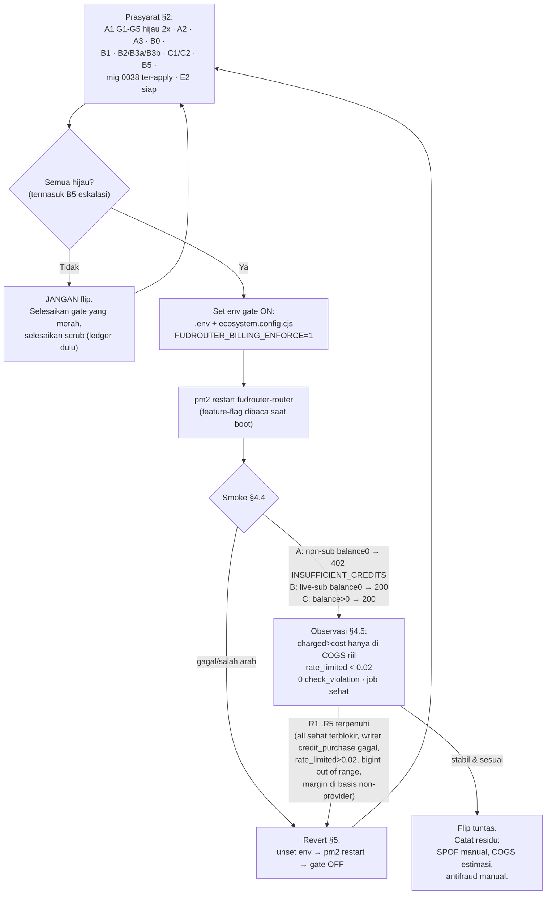

# E2 — Runbook Flip + Revert: `FreeAccessNoPaymentGateway` → runtime flag `FUDROUTER_BILLING_ENFORCE`

- **Branch:** `feat/economic-layer` (HEAD `1f613ca`, host `dwizzy`, path `~/fudrouter`).
- **Sprint:** S5 (E2). **Status dokumen:** operator-only. Tidak ada robot/CI yang menjalankan langkah apa pun di bawah; setiap gate dibaca dan diketik operator (disiplin yang sama dengan `ops/scrub-execution-checklist.md`).
- **Rujukan:** `docs/plans/fr-approve.md` §5 (gate B4), `docs/plans/fr-revised.md` §0/§4/§7 (invariant revisi), `docs/specs/2026-11-08-F1-balance-runbook.md` §5 (go/no-go F1), `docs/specs/2026-11-08-economic-layer-design.md` §8/§9 dan `docs/specs/2026-11-08-economic-layer-rollout.md`.

> **Satu baris:** jangan flip sampai §2 seluruhnya hijau. Flip kini = *set env + restart*, bukan *edit + rebuild* (P1.8 tertutup). Revert = *unset env + restart*.

---

## 1. Ringkasan apa yang berubah saat flip

Flag kompilasi `var FreeAccessNoPaymentGateway = true` (`backend/go/internal/store/limits.go:81`) adalah satu-satunya pemutus ENFORCEMENT saldo. Selama `true`, balance tetap termeter ke ledger tapi **gerbang saldo nonaktif** — semua akun `active` lolos di bawah rate-limit. Saat flag menjadi `false` (gate AKTIF), tiga hal hidup serentak:

| # | Gate | Lokasi persis | Perilaku setelah flip |
|---|---|---|---|
| 1 | **Balance hard stop** — `402 INSUFFICIENT_CREDITS` saat `balance_micro <= hard_stop_threshold_micro` | `proxy/budget.go:95` (`!live && !store.FreeAccessNoPaymentGateway && acct.BalanceMicro <= acct.HardStopThresholdMicro`) | Akun non-subscriber dengan saldo ≤ 0 ditolak 402 **sebelum dispatch upstream** (proven by `budget_gate_test.go` — upstream never dialled). |
| 2 | **Low-balance alert** `raiseLowBalance` (70/90/100% isi ulang) | `proxy/lifecycle.go:1412` (`if charge != nil && !store.FreeAccessNoPaymentGateway && (charge.Warning || charge.HardStop)`) | Alert `low_balance` aktif lagi (selama free-access alert itu bising permanen, makanya dimatikan). |
| 3 | **Subscription-aware (B0 / inv#2)** | `proxy/entitlement_gate.go` + `proxy/budget.go:59` (`checkSubscription` dijalankan HANYA saat gate live) | Akun dengan `subscription` **live** lolos walau `balance=0` — `live_subscription OR balance > threshold` = "sehat". Akun dengan window **lapsed/cancelled** ditolak aturan rule-12 "expired", akun **never-subscribed** jatuh ke gate saldo. |
| 4 | **Charge-result hard stop** (ledger debit) | `store/billing.go:270` (`if res.HardStop && !FreeAccessNoPaymentGateway`) | `ChargeResult.HardStop` ikut menolak debit ketika saldo menyentuh ambang. |

Kode 402 yang dikirim klien: `routing.ErrCodeInsufficientCredits = "INSUFFICIENT_CREDITS"` (`routing/execute.go:360`), dipetakan di admission `lifecycle.go:238` via `lc.reject(routing.ErrCodeInsufficientCredits, err.Error(), "client_error", http.StatusPaymentRequired)`.

**Yang TIDAK berubah saat flip:** meter & ledger tetap berjalan persis seperti sekarang (revenue numbers nyata); status `suspended` tetap menolak (independen dari flag, `budget.go`); urutan *ledger-dulu-baru-cache* scrub tetap wajib (§6).

---

## 2. Prasyarat go/no-go numerik (harus HIJAU semua SEBELUM flip)

Sumber numerik: `docs/specs/2026-11-08-F1-balance-runbook.md` §5.1 (G1–G5) + §5.2 (fungsional), `docs/plans/fr-approve.md` §5 (gate B4), `docs/plans/fr-revised.md` §4/§6.

### 2.1 Gate numerik A1 — G1–G5 (scrub anomali saldo)

Semua query `0`/`true`, diverifikasi **dua kali berturut** (idempoten). Verifikasi gate pakai `ops/verify/scrub-gates.sql` (G1–G5 + V6).

| # | Kriteria | Invariant (F1 runbook) | Target |
|---|---|---|---|
| G1 | Akun out-of-range | §2 invariant (b): `balance_micro >= 1e12 OR <= -1e12` | `0` |
| G2 | Drift per-akun | §2 invariant (c): `balance_micro <> SUM(credit_ledger)` | `0` |
| G3 | Baris ledger implausible | §2 invariant (a): `\|amount_micro\| > 1e12` | `0` |
| G4 | Σledger == Σbalance | §2 invariant (d): selisih global | `0` |
| G5 | Scrub idempoten | ulangi §2 langkah 4–6 | `2×` bersih; putaran kedua mengubah `0` baris |

**Bukti anomali yang harus hilang** (produksi 2026-11-08, F1 runbook §1/§6): 2 baris `credit_purchase` korup `amount_micro=5555555555555000000` (idempotency_key `purchase:txn_01a178b8-3ef5-…` dan `purchase:txn_01a178b8-3eff-…`), akun `bac_wrk_usr_VjOnC8IZktzGBVXBagJkGJPEhoocKe5L` dengan drift `-5555555555555000000`. Saldo bersih akun itu harus menjadi **432211272800** µUSD (bukan nol).

**Cara eksekusi scrub yang disetujui** (satu-satunya jalur): `ops/scrub-execution-checklist.md` — urutan report → review → pre-image → repair → re-report → gate → idempoten. Skrip: `ops/scrub-balance-anomaly.sql` (report), `ops/scrub-balance-anomaly.step1.sql` (ledger), `.step2.sql` (cache). Pre-image/undo: `ops/rollback/scrub-balance-anomaly.rollback.sql` + `.undo.sql`. A1 belum dijalankan; ini langkah **manual operator** (bukan bagian E2).

### 2.2 Prasyarat fungsional (F1 runbook §5.2 + fr-approve §5)

| # | Prasyarat | Status di branch ini | Verifikasi |
|---|---|---|---|
| A2 | `reconcileAll` isolate-exclude (akun total > int64 → `status='quarantine'` + `alert_event`, bukan cast) | committed `d970ce2` | `billing.ts` isolate-exclude; `checkBudgets` menolak `status != active` |
| A3 | Ceiling add-credit (>1e12 µUSD ditolak) + rename namespace `admin_credit:` | committed `d970ce2` | migrasi `0036_admin_credit_namespace.sql`; test 4-case |
| B0 | Wire `entitlement.CheckSubscription`/`LatestSubscription` ke admission (subscription-aware) | committed `68df09d` | `proxy/entitlement_gate.go` + `budget.go:59`; `subscription.go:LatestSubscription` |
| B1 | Gateway interface (ADR-0008) | committed `3159a5d` | `docs/decisions/0008-payment-gateway-interface.md` (E1) |
| B2/B3 | Grant writer + inbound webhook + confirm→grant loop (satu siklus tertutup `payment → credit_purchase → balance_micro`) | committed `3159a5d` `2975b87` | `subscription.go:GrantSubscription` idempoten (0038) |
| B3b | Confirm→grant loop tertutup & teruji replay (1 payment = 1 credit = 1 balance) | committed `2975b87` | test replay webhook = 1 grant |
| C1/C2 | Telegram + Discord payment adapter (shared-TS handler) | committed `1f613ca` | DoD: `payment.status='confirmed' AND channel IN ('telegram','discord')` > 0 dalam 48 jam |
| B5 | Eskalasi/fallback approval: ≥2 approver via env (bukan hardcode `@zupaxx`), TTL + approve cadangan | **Sprint 6 — BELUM** | gate B4 TIDAK lolos sebelum B5 hijau |
| E2 | Runbook flip+revert ini | **dokumen ini** | — |
| Mig 0038 | `subscription_payment_id_uniq` ter-apply | committed, **belum ter-apply di prod** | `ops/migrate.sh` |

**MIGRASI 0038 WAJIB ter-apply SEBELUM grant writer live.** `backend/go/migrations/0038_subscription_payment_id_uniq.sql` menambah partial UNIQUE index `subscription(payment_id) WHERE payment_id IS NOT NULL` — penghenti idempotensi agar double-callback tidak menciptakan dua window `sub_…` (dua kunci). Rollback: `ops/rollback/0038_subscription_payment_id_uniq.rollback.sql`.

```bash
cd ~/fudrouter
DATABASE_URL=postgres://… ops/migrate.sh            # apply pending (idempoten; mencatat ke schema_migration)
DATABASE_URL=postgres://… ops/migrate.sh status     # pastikan 0038 tertulis applied
```

---

## 3. Konversi ke feature-flag (B4)

**Nama env:** `FUDROUTER_BILLING_ENFORCE`.
**Default (unset):** gate **OFF** (= state kompilasi saat ini `FreeAccessNoPaymentGateway = true`).
**Nilai truthy (sama dengan `envBool`):** `1`, `true`, `yes`, `on` — fail-closed (`store/store.go:228-231`).

### Spesifikasi perubahan kode (B4, belum dikerjakan — bagian ini menjelaskan apa yang akan dikerjakan saat flip)

1. **Ganti default kompilasi.** `backend/go/internal/store/limits.go:81` tetap `var FreeAccessNoPaymentGateway = true` sebagai default-boot TANPA env; TIDAK lagi diedit untuk cutover.
2. **Baca env di startup.** Di `store.New()` (`backend/go/internal/store/store.go`, bagian yang sudah membaca `envBool("ROUTER_ALLOW_DEV_PROVIDERS")` di baris `:97`), tambahkan tepat setelahnya:

```go
// FUDROUTER_BILLING_ENFORCE: runtime flip for the balance gate (E2 / P1.8).
// Unset -> FreeAccessNoPaymentGateway stays true -> gate OFF (today's state).
// Truthy -> false -> gate ON. Read once at boot; a flip/revert is restart.
if envBool("FUDROUTER_BILLING_ENFORCE") {
	FreeAccessNoPaymentGateway = false
}
```

3. **Titik baca.** `store.New()` dipanggil `cmd/gateway/main.go:100` (`st, err := store.New(ctx, dsn)`), jadi flag terbaca **sekali saat boot** — bukan hot-reload. Batas downtime untuk flip/revert = restart `pm2 restart fudrouter-router` plus graceful drain `kill_timeout: 25000` (`ecosystem.config.cjs:47`) — catatan eksplisit di `fr-approve.md` §3(b).
4. **Test tetap utuh.** `budget_gate_test.go` / `admission_cache_test.go` mem-flip `store.FreeAccessNoPaymentGateway` langsung (bukan via env) dan me-restore deferred; karena `New()` hanya menulis `false` bila env truthy (env TIDAK diset saat test), perilaku test tidak berubah.

**Apa yang menghilang:** "rebuild Go" jadi **"restart + set env"**. Sebelumnya flip = edit `limits.go:81` → `go build` → `pm2 restart`; kini = set env → `pm2 restart`.

### 4. Wiring env (di mana env ditaruh)

`backend/go/run.sh` meng-`source` root `.env` sebelum `exec ./bin/fudrouter-router` (pola yang sudah ada untuk `DATABASE_URL`, `VALKEY_URL`, dll). Jadi env cukup ditambah di **dua** tempat:

1. `~/fudrouter/.env` (root, satu baris baru): `FUDROUTER_BILLING_ENFORCE=1`
2. `ecosystem.config.cjs`, app `fudrouter-router` (`name:` baris `:37`) → blok `env:{…}` (baris `:41-49`), tambah satu baris: `FUDROUTER_BILLING_ENFORCE: '1'`.

Mengapa keduanya: `.env` adalah sumber truth saat `run.sh` dijalankan; blok `env` di `ecosystem.config.cjs` dianjurkan agar flag tidak bergantung pada state shell operator saat `pm2 start/restart` (PM2 menyalin env klien; lihat komentar `ecosystem.config.cjs:5-14`). Menaruh di keduanya menghilangkan "lupa source .env" sebagai failure mode.

---

## 4. Prosedur flip

### 4.1 Verifikasi semua prasyarat (§2) hijau

- Jalankan/​baca `ops/verify/scrub-gates.sql` → G1–G5 `0`/`PASS` **dua kali berturut**.
- Pastikan A2/A3/B0/B1/B2/B3a/B3b/C1/C2 hijau (committed di branch + teruji).
- **B5 hijau** (≥2 approver via env + TTL + approve cadangan teruji-offline) — Sprint 6.
- E2 (dokumen ini) siap.
- Migrasi 0038 **ter-apply** (`ops/migrate.sh status`).

> Kalau SATU pun tidak hijau → berhenti, jangan set env. Ini gate keras B4 (`fr-approve.md` §5: `A1,A2,A3,B0,B3b,C1/C2,E2,B5`).

### 4.2 Set env (gate ON)

```bash
cd ~/fudrouter

# 1. root .env
printf 'FUDROUTER_BILLING_ENFORCE=1\n' >> .env

# 2. ecosystem.config.cjs — blok env app fudrouter-router (baris :41-49)
#    tambahkan:  FUDROUTER_BILLING_ENFORCE: '1',

# 3. verifikasi terbaca (fail-closed: hanya truthy yang menang)
grep -n 'FUDROUTER_BILLING_ENFORCE' .env ecosystem.config.cjs
```

### 4.3 Deploy/restart biner Go

```bash
cd ~/fudrouter
# B4 selesai dulu: kode feature-flag (section 3) ter-commit + binary dibuild.
# Restart aplikasi router (bukan reload — flag dibaca sekali saat boot).
pm2 restart fudrouter-router
sleep 6
curl -sS -o /dev/null -w 'health=%{http_code}\n' http://127.0.0.1:8100/health   # harus 200
```

> Hanya `pm2 restart fudrouter-router`; jangan `pm2 reload` (reload memakai proses yang sudah ada dan flag boot tidak terbaca ulang — lihat `ops/cutover-p2b.sh:145`).

### 4.4 Smoke test (3 akun, urutan persis)

Siapkan tiga API key di **staging** dulu (opsi alternatif: staging clone via `ops/scrub-execution-checklist.md` §12), masing-masing `billing_account.status='active'`:

**A. Akun tanpa subscription + `balance_micro=0`** → harus **402 `INSUFFICIENT_CREDITS`**:

```bash
printf 'A404...\n'    # catat: expect 402
curl -sS -w '\nHTTP %{http_code}\n' -X POST http://127.0.0.1:8100/v1/chat/completions \
  -H "Authorization: Bearer <KEY_A>" -H 'Content-Type: application/json' \
  -d '{"model":"<model>","messages":[{"role":"user","content":"ping"}]}'
# body.code harus = INSUFFICIENT_CREDITS ; tidak ada attempt upstream di request_attempt
```

**B. Akun live subscription + `balance_micro=0`** → harus **200** (inv#2: live lolos walau 0):

```bash
curl -sS -w '\nHTTP %{http_code}\n' -X POST http://127.0.0.1:8100/v1/chat/completions \
  -H "Authorization: Bearer <KEY_B>" -H 'Content-Type: application/json' \
  -d '{"model":"<model>","messages":[{"role":"user","content":"ping"}]}'
```

Pastikan B benar-benar live (window `active` + `expires_at > now()`) — klasifikasi live vs expired ada di `proxy/entitlement_gate.go` (status `active` + masa depan; window `cancelled/refunded` TIDAK live).

**C. Akun tanpa subscription + `balance_micro > hard_stop_threshold_micro`** → harus **200**:

```bash
curl -sS -w '\nHTTP %{http_code}\n' -X POST http://127.0.0.1:8100/v1/chat/completions \
  -H "Authorization: Bearer <KEY_C>" -H 'Content-Type: application/json' \
  -d '{"model":"<model>","messages":[{"role":"user","content":"ping"}]}'
```

Klasifikasi akun untuk memilih KEY_A/B/C (cek `live_sub`):

```sql
SELECT ba.id, ba.balance_micro, ba.hard_stop_threshold_micro,
       EXISTS (SELECT 1 FROM subscription s
                WHERE s.account_id = ba.id
                  AND s.status='active' AND s.expires_at > now()) AS live_sub
FROM billing_account ba WHERE ba.status='active';
```

Boundary gate: `<=` di `budget.go:95` (saldo aTAU di bawah hard stop ditolak); default `hard_stop_threshold_micro = 0`, `warning_threshold_micro = 10000000` (`0006_platform_schema.sql:520-521`).

### 4.5 Observasi pasca-flip

- `charged > cost` (margin) harus naik **hanya** di bucket/provider dengan COGS riil (`billing_basis='provider'` + `provider_cost_micro IS NOT NULL`); markup di atas retail/alias = imajiner (desain §8 invariant 1, rollout metric). Query arsip desain: `request_log` `billing_basis`/`cost_basis`/`provider_cost_micro`.
- `rate_limited` ratio < 0.02 (insiden 1 Nov 170.556/172.541 tidak terulang).
- 0 baris `request_log` melanggar CHECK `request_log_markup_basis_check` / `request_log_farm_zero_check`.
- Job `billing_aggregation` sehat (tidak `bigint out of range` — itu tanda reconcile jalan sebelum scrub, §6).
- `payment.status='confirmed'` > 0 dalam 48 jam (DoD C1/C2).

---

## 5. Prosedur revert

Revert = **unset env → restart → gate OFF** (state persis sebelum flip; tidak ada rebuild).

```bash
cd ~/fudrouter

# 1. hapus/env non-aktif (kosongkan juga dianggap OFF — envBool fail-closed)
sed -i '/^FUDROUTER_BILLING_ENFORCE=/d' .env
#    dan hapus baris  FUDROUTER_BILLING_ENFORCE: ..  dari ecosystem.config.cjs env fudrouter-router

# 2. restart baca boot ulang
pm2 restart fudrouter-router
sleep 6
curl -sS -o /dev/null -w 'health=%{http_code}\n' http://127.0.0.1:8100/health

# 3. konfirmasi gate balik OFF: akun nontop-up balance=0 harus kembali 200 (bukan 402)
```

### Ambang yang memicu revert (lakukan revert bila salah satu terpenuhi)

| # | Sinyal | Tindakan |
|---|---|---|
| R1 | **Semua akun sehat terblokir** — akun non-sub dengan `balance > 0` dipantau tiba-tiba 402 (mis. cache admission stale, atau reconcile menulis balance salah) | unset + restart, triase `billing_account`/`admission` cache |
| R2 | **Writer `credit_purchase` gagal di prod** — jalur top-up benar-benar mati; tanpa jalur kredit tiap akun yang menyentuh 0 terkunci permanen (F1 runbook §5.2(1)) | unset + restart, perbaiki writer, baru flip ulang |
| R3 | `rate_limited` ratio melonjak > 0.02 (gerbang salah menolak) | unset + restart + forensik |
| R4 | `billing_aggregation` error `bigint out of range` (reconcile menandakan scrub tidak pernah selesai §6) | unset + restart, selesaikan scrub, baru flip ulang |
| R5 | `charged > cost` naik di bucket dengan basis non-provider (markup imajiner, invariant 1) | unset + restart + audit `provider_cost_rule` |

Gate kembali kaki ke kompilasi default: `FreeAccessNoPaymentGateway` kembali `true` karena `envBool` membaca kosong/absent → kondisi `if` tidak terpenuhi → var tetap `true`.

> `pm2 restart` cukup; **jangan** `pm2 reload` (flag boot tidak dibaca ulang). Downtime terbatas graceful drain 25s (`ecosystem.config.cjs:47` + `main.go` `srv.Shutdown` 20s).

---

## 6. Peringatan (wajib dibaca sebelum menyentuh produksi)

1. **Reconcile TANPA scrub menyalin anomali.** `reconcileAll` (`billing.ts`) = `UPDATE balance_micro = SUM(credit_ledger)` — ia menyalin apa pun, tidak menilai kewajaran. Jalankan sebelum Step 1 scrub → ia menulis `1.11e19` (bukan menghapus) ke cache; dan **hari ini** bahkan gagal `bigint out of range` untuk seluruh batch. Urutan *ledger-dulu-baru-cache* satu-satunya yang aman (desain §8 invariant 4). Rujuk `docs/specs/2026-11-08-F1-balance-runbook.md` §4.
2. **Perbaikan saldo prod = manual operator**, bukan robot. Pakai `ops/scrub-balance-anomaly.step1.sql` (ledger) lalu `.step2.sql` (cache), dengan pre-image `ops/rollback/scrub-balance-anomaly.rollback.sql` + undo `.undo.sql`. Jalankan di **staging** sampai §7 checklist hijau 2× sebelum produksi (`ops/scrub-execution-checklist.md` §1).
3. **Migration 0038 WAJIB sebelum grant writer live.** Tanpa `subscription_payment_id_uniq`, dua callback bersamaan bisa menciptakan dua window `sub_…` (double grant). Terapkan via `ops/migrate.sh` (§2.2); rollback `ops/rollback/0038_subscription_payment_id_uniq.rollback.sql`.
4. **Threshold default disengaja?** `hard_stop_threshold_micro=0`, `warning_threshold_micro=10000000` ($10 µUSD) di `0006_platform_schema.sql:520-521`. Review angka untuk akun berbayar SEBELUM gate aktif (F1 runbook §5.2(3)).
5. **SPOF admin** belum hilang (anti-fraud & farm tetap manual); B5 (eskalasi) adalah prasyarat flip, bukan nice-to-have — tanpa B5 jangan flip.
6. **Restart masih diperlukan** — feature-flag menghapus rebuild, TIDAK menghapus downtime restart (fr-approve §3(b)).

---

## 7. Diagram mermaid — flip decision



---

### Rujukan file:line inti

| Fakta | Lokasi |
|---|---|
| Flag kompilasi default `true` | `backend/go/internal/store/limits.go:81` |
| Gate hard-stop admission | `backend/go/internal/proxy/budget.go:95` |
| Wire subscription (B0) | `backend/go/internal/proxy/budget.go:59` + `backend/go/internal/proxy/entitlement_gate.go` |
| Low-balance alert | `backend/go/internal/proxy/lifecycle.go:1412` |
| Charge-result hard stop | `backend/go/internal/store/billing.go:270` |
| `envBool` truthy/fail-closed | `backend/go/internal/store/store.go:228-231` |
| Precedence env read (`ROUTER_ALLOW_DEV_PROVIDERS`) | `backend/go/internal/store/store.go:97` |
| `store.New` dipanggil di `main` | `backend/go/cmd/gateway/main.go:100` |
| Env lain di `main` (`ROUTER_ADDR`/`DATABASE_URL`/Valkey) | `backend/go/cmd/gateway/main.go:92,96,114` |
| `run.sh` source root `.env` | `backend/go/run.sh` |
| App router PM2 + blok env | `ecosystem.config.cjs:37,39,41-49` |
| Kode 402 | `backend/go/internal/routing/execute.go:360` → `backend/go/internal/proxy/lifecycle.go:238` |
| Migrasi 0038 + rollback | `backend/go/migrations/0038_subscription_payment_id_uniq.sql` / `ops/rollback/0038_subscription_payment_id_uniq.rollback.sql` |
| Threshold default | `backend/go/migrations/0006_platform_schema.sql:520-521` |
| Scrub (report/step/pre-image/checklist) | `ops/scrub-balance-anomaly.{sql,step1.sql,step2.sql}` / `ops/rollback/scrub-balance-anomaly.{rollback,undo}.sql` / `ops/scrub-execution-checklist.md` / `ops/verify/scrub-gates.sql` |
| F1 runbook (go/no-go sumber) | `docs/specs/2026-11-08-F1-balance-runbook.md` §5 |
